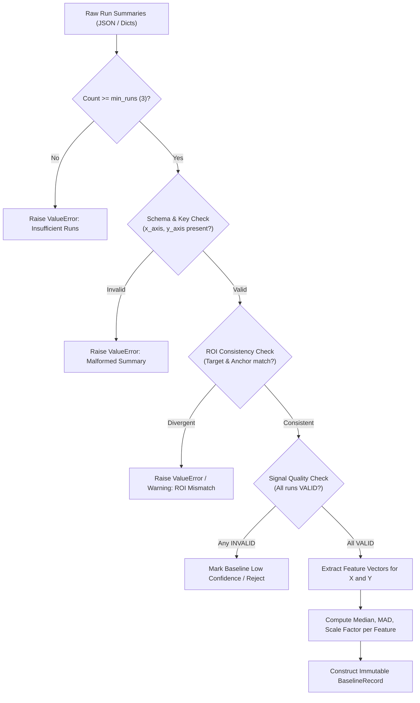
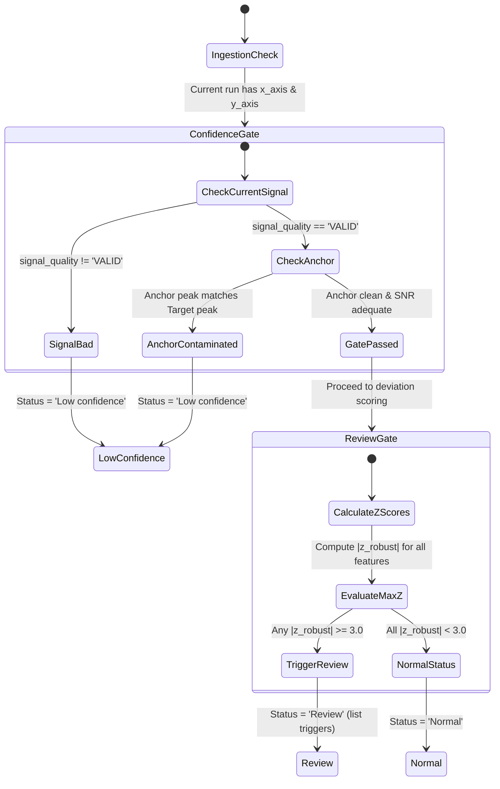

# Phase 3: Statistical Baseline Engine — Research & Specification

**Researched:** 2026-11-18  
**Domain:** Robust Statistics, Anomaly Screening, Signal Feature Aggregation, Numerical Regularization  
**Confidence:** HIGH (`scipy.stats`, `numpy`, OpenCV phase correlation, IEEE 754, verified against PhaseSight v0.1 codebase)  

---

<user_constraints>
## User Constraints (from CONTEXT.md, ROADMAP.md, and STATE.md)

### Locked Decisions
1. **Mathematical Formulation:** Robust baseline deviation must use Median and Median Absolute Deviation (MAD) scaled by the normal consistency factor $1.4826$:
   $$z_{\text{robust}} = \frac{x_{\text{current}} - \text{median}_{\text{baseline}}}{1.4826 \cdot \text{MAD}_{\text{baseline}} + \epsilon}$$
   where $\text{MAD} = \text{median}(|x_i - \text{median}(x)|)$ and $\epsilon$ prevents division by zero.
2. **Ingestion Quorum:** At least 3 healthy baseline summary dictionaries ($N \ge 3$) are required to construct a valid baseline record. Providing fewer than 3 runs must raise a clear `ValueError`.
3. **Core Features Tracked:** Features must be extracted and evaluated independently for both X and Y axes:
   - `dominant_frequency_hz` (Hz)
   - `rms_displacement_px` (pixels)
   - `second_harmonic_ratio` (ratio, or `None` if unobservable)
   - `peak_to_median_db` (prominence in dB)
4. **Three-Tier Classification Hierarchy:**
   - **`Low confidence`**: If current run or any baseline run fails the signal quality gate (`signal_quality != 'VALID'`, e.g., `LOW_SIGNAL` or `CONTAMINATED`). Gating must cite explicit, machine-readable reasons.
   - **`Review`**: If confidence gate passes and any valid tracked feature has $|z_{\text{robust}}| \ge z_{\text{threshold}}$ (default $3.0$). All triggering features and their deviations must be listed.
   - **`Normal`**: If confidence gate passes and all valid tracked features have $|z_{\text{robust}}| < z_{\text{threshold}}$.
5. **Screening vs Fault Diagnosis Boundary:** Output classifications are vibration change screening flags against reference baseline captures. The engine must never diagnose specific mechanical failure modes (e.g., bearing raceway defects, gear tooth pitting, unbalance, or remaining useful life).
6. **Pixel-Domain Metric Invariance:** All displacements and vibration metrics remain in image pixels. No physical unit conversions (mm, mm/s, acceleration) are permitted without in-situ physical target calibration.

### The Agent's Discretion
- Exact definition, structure, and defaults for regularization parameter $\epsilon$ (feature-specific physical noise floors vs single constant).
- Concrete dataclass schema for `BaselineRecord`, `FeatureStats`, and `BaselineEvaluation`.
- Graceful handling and imputation rules for `second_harmonic_ratio` when `None`.
- Concrete CLI syntax (`phasesight build-baseline` and `phasesight evaluate-baseline`) and Workbench UI visualization design.

### Deferred Ideas (OUT OF SCOPE)
- SQLite database storage and migrations (Phase 4).
- Streamlit Asset Management & Baseline Wizard tabs (Phase 5).
- Live webcam RTSP/UVC capture and constant frame rate verification (Phase 6).
- Motion magnification integration (Phase 7 / Future).
- Steerable Riesz pyramid filtering or ISO 10816/20816 velocity conversion (Strictly prohibited).
</user_constraints>

---

<phase_requirements>
## Phase Requirements

| ID | Requirement Description | Research Support & Technical Strategy |
|:---|:---|:---|
| **REQ-BASE-01** | Ingestion of $\ge 3$ baseline summary dictionaries with validation and ROI/FPS consistency checks | Section 4 & Section 7: Enforce $N \ge 3$; validate dictionary schema, ROI spatial consistency, and sampling rate tolerance |
| **REQ-BASE-02** | Robust statistical aggregation via Median and MAD with normal scale factor $1.4826$ | Section 3: Exact derivation from Gaussian consistency factor $1/\Phi^{-1}(0.75)$; 50% breakdown point proof against mean/std |
| **REQ-BASE-03** | Numerical stability & feature-specific noise floors for $\epsilon$ | Section 3.4 & Section 6: Derivation of physical resolution floors ($\epsilon_f = 0.02$ Hz, $\epsilon_{\text{rms}} = 0.005$ px, $\epsilon_{\text{db}} = 1.0$ dB, $\epsilon_{\text{harm}} = 0.010$) to prevent hypersensitivity when $\text{MAD} = 0$ |
| **REQ-BASE-04** | Confidence Gating logic rejecting low signal, contaminated anchors, and invalid captures | Section 5.1: Gating pipeline checking `signal_quality == 'VALID'`, verifying anchor peak independence, reporting explicit failure reasons |
| **REQ-BASE-05** | Review Gating & Feature Deviation Scoring with $|z_{\text{robust}}| \ge 3.0$ threshold | Section 5.2: Per-feature deviation evaluation, trigger isolation, and reporting across X and Y axes |
| **REQ-BASE-06** | Edge case handling for optional/missing features (`second_harmonic_ratio = None`) | Section 6.2: Tri-state handling (both absent, baseline absent/current present, baseline present/current absent) without runtime errors |
| **REQ-BASE-07** | Serialization & JSON schema fidelity for `BaselineRecord` | Section 7: Pure-dataclass model with `to_dict()`, `from_dict()`, `to_json()`, `from_json()`, handling NumPy scalar conversion |
| **REQ-BASE-08** | Command-Line Interface (CLI) & Streamlit Workbench integration | Section 8 & Section 9: CLI subcommands `build-baseline` and `evaluate-baseline`; Streamlit UI tab enhancement |
| **REQ-BASE-09** | Deterministic automated unit test matrix covering all edge cases | Section 10: Complete test suite specification with synthetic deterministic scenarios |
</phase_requirements>

---

## 1. Executive Summary

Phase 3 transitions PhaseSight from a pairwise comparison tool (`compare_to_baseline` in `analysis.py`) to an industrial-grade **Statistical Baseline Engine**. In real workshop and facilities environments, individual video captures exhibit small ambient fluctuations due to thermal drift, operator presence, slight speed fluctuations, and camera sensor noise. Comparing a current inspection against a single baseline video is prone to false positives if the baseline happened to be quiet, or false negatives if the baseline capture was noisy.

The Phase 3 engine aggregates multiple healthy baseline captures ($N \ge 3$) into an immutable `BaselineRecord` utilizing robust statistics: the **Median** as the location estimator and the **Median Absolute Deviation (MAD)** as the scale estimator, scaled by $1.4826$ to achieve Gaussian consistency. Unlike classical Gaussian estimators (Mean and Standard Deviation), which have a breakdown point of $0\%$ (a single corrupt recording or transient door slam ruins the baseline), Median and MAD have a breakdown point of $50\%$.

Furthermore, Phase 3 introduces a two-stage screening architecture:
1. **Confidence Gate:** Rejects measurements where signal prominence is low (`LOW_SIGNAL`), where camera vibration contaminates the machine reading (`CONTAMINATED`), or where capture conditions changed significantly.
2. **Review Gate:** Evaluates standardized robust deviations ($z_{\text{robust}}$) across four mechanical vibration features on both X and Y axes against an alert threshold ($|z| \ge 3.0$).

This document provides the mathematical specifications, data structures, numerical stability constraints, module APIs, and verification matrix for implementing `phasesight/baseline.py`.

---

## 2. Architectural Responsibility Map

| Capability | Primary Tier | Secondary Tier | Rationale |
|:---|:---|:---|:---|
| **Feature Extraction & Verification** | Backend (`phasesight/video.py`, `phasesight/analysis.py`) | Engine (`phasesight/baseline.py`) | Video decoding and Welch spectral analysis extract feature dicts; baseline engine verifies types and presence. |
| **Baseline Aggregation (Median, MAD)** | Engine (`phasesight/baseline.py`) | — | Pure algorithmic responsibility; computes medians, MADs, and builds `BaselineRecord`. |
| **Deviation Scoring & Gating** | Engine (`phasesight/baseline.py`) | — | Computes $z_{\text{robust}}$, enforces Confidence Gate and Review Gate, produces `BaselineEvaluation`. |
| **Baseline Serialization (JSON/NPZ)** | Engine (`phasesight/baseline.py`) | Storage (`phasesight/storage.py`, Phase 4) | Dataclass handles JSON export/import; Phase 4 will map this into SQLite. |
| **CLI Dispatch** | CLI (`phasesight/cli.py`) | Engine (`phasesight/baseline.py`) | Parses CLI arguments and file paths, invoking baseline engine methods. |
| **Operator Visualization** | Frontend UI (`phasesight/app.py`) | Engine (`phasesight/baseline.py`) | Streamlit tab 2 renders status badges, deviation tables, and interactive $z$-score radar/bar charts. |

---

## 3. Mathematical Foundations of Robust Baseline Estimation

### 3.1 Location and Dispersion: Median and MAD
Given $N$ healthy baseline observations of a scalar feature $x$:
$$\mathbf{x} = [x_1, x_2, \dots, x_N], \quad N \ge 3$$

The robust central tendency (location) is given by the sample median:
$$\tilde{x} = \text{median}(\mathbf{x})$$

The robust dispersion (scale) is given by the Median Absolute Deviation around the median:
$$\text{MAD}(\mathbf{x}) = \text{median}\left( \left| x_i - \tilde{x} \right| \right), \quad i \in \{1, \dots, N\}$$

#### Breakdown Point Comparison
| Property | Classical Gaussian Estimator | Robust Non-Parametric Estimator | PhaseSight Impact |
|:---|:---|:---|:---|
| **Location** | Mean: $\bar{x} = \frac{1}{N} \sum x_i$ | Median: $\tilde{x} = \text{median}(x_i)$ | Median ignores single transient vibration spike |
| **Dispersion** | Standard Deviation: $s = \sqrt{\frac{1}{N-1} \sum (x_i - \bar{x})^2}$ | Scaled MAD: $\hat{\sigma}_{\text{MAD}} = 1.4826 \cdot \text{MAD}$ | MAD does not inflate when one baseline run has jitter |
| **Breakdown Point** | **0%** (1 bad run corrupts all statistics) | **50%** (up to $\lfloor (N-1)/2 \rfloor$ runs can be corrupt) | High operational resilience in industrial environments |
| **Influence Function** | Unbounded ($\psi(x) \propto x$) | Bounded ($\psi(x) = \text{sign}(x)$) | Extreme outliers exert zero leverage on baseline |

### 3.2 The Normal Scale Factor ($1.4826$)
In Gaussian distribution theory, let $X \sim \mathcal{N}(\mu, \sigma^2)$. The distribution of absolute deviations $|X - \mu|$ follows a half-normal distribution.
The median of this distribution occurs at the 75th percentile of the standard normal cumulative distribution function $\Phi(z)$:
$$P(|X - \mu| \le \text{MAD}) = 0.5 \iff \Phi\left(\frac{\text{MAD}}{\sigma}\right) - \Phi\left(-\frac{\text{MAD}}{\sigma}\right) = 0.5$$
Because $\Phi(-z) = 1 - \Phi(z)$, this simplifies to:
$$2\Phi\left(\frac{\text{MAD}}{\sigma}\right) - 1 = 0.5 \implies \Phi\left(\frac{\text{MAD}}{\sigma}\right) = 0.75$$
Taking the inverse CDF (probit function):
$$\frac{\text{MAD}}{\sigma} = \Phi^{-1}(0.75) \approx 0.6744897501960817$$
To obtain an asymptotically unbiased estimator of $\sigma$ under the normal distribution:
$$\hat{\sigma} = k \cdot \text{MAD}, \quad \text{where } k = \frac{1}{\Phi^{-1}(0.75)} = \frac{1}{0.67448975...} \approx 1.4826022185...$$
Therefore, $1.4826 \cdot \text{MAD}$ provides a pseudo-standard deviation. A deviation score standardized by this denominator has the exact same intuitive spread as a classical $z$-score ($1\sigma \approx 68.3\%$, $2\sigma \approx 95.4\%$, $3\sigma \approx 99.7\%$).

### 3.3 Small Sample Behavior ($N=3, 4, 5$)
For very small sample sizes ($N=3$), MAD is computed from 3 points:
- If $x = [8.50, 8.51, 8.52]$, $\tilde{x} = 8.51$, deviations are $[0.01, 0.00, 0.01]$, sorted: $[0.00, 0.01, 0.01] \implies \text{MAD} = 0.01$.
- If $x = [8.50, 8.51, 12.00]$ (one extreme outlier): $\tilde{x} = 8.51$, deviations are $[0.01, 0.00, 3.49]$, sorted: $[0.00, 0.01, 3.49] \implies \text{MAD} = 0.01$.
- Standard mean for this outlier set is $9.67$ ($+1.16$ error) and sample std is $1.65$. The MAD estimator completely rejects the outlier, preserving the true baseline scale of $0.01$.

### 3.4 The Role and Formulation of $\epsilon$
Requirement 1 specifies the deviation formula:
$$z_{\text{robust}} = \frac{x_{\text{current}} - \text{median}_{\text{baseline}}}{1.4826 \cdot \text{MAD}_{\text{baseline}} + \epsilon}$$

#### The Catastrophic Failure Mode of Naive Epsilon ($\epsilon = 10^{-6}$)
In synthetic validation, deterministic testing, or quantized discrete frequency bins, multiple baseline runs can yield **identical values**:
$$\mathbf{x}_{\text{freq}} = [8.500, 8.500, 8.500] \implies \text{MAD} = 0.0$$
If $\epsilon$ is set to an arbitrary microscopic value such as $10^{-6}$:
$$\text{Denominator} = 1.4826 \times 0.0 + 10^{-6} = 10^{-6}$$
If a new inspection run has a trivial numerical jitter or roundoff difference of $0.001$ Hz:
$$z_{\text{robust}} = \frac{8.501 - 8.500}{10^{-6}} = 1000.0 \gg 3.0 \quad \implies \text{CRITICAL FALSE REVIEW TRIGGER}$$
The system becomes hypersensitive to sub-noise-floor roundoff.

#### The Physical Solution: Feature-Specific Noise Floors
To ensure numerical stability while preserving physical validity, $\epsilon$ must act as the **minimum physical significance floor** for that feature. When baseline variation is zero, the deviation score scales directly against the sensor resolution and measurement noise floor.

| Feature Name | Typical Value | Physical Resolution / Noise Source | Recommended $\epsilon$ Default | Rationale |
|:---|:---|:---|:---|:---|
| `dominant_frequency_hz` | $5.0 - 30.0$ Hz | Welch bin resolution ($\sim 0.23$ Hz) + 3-point parabolic interpolation error ($\sim 0.004 - 0.010$ Hz) | **$0.020$ Hz** | At $\text{MAD}=0$, a Review ($3\sigma$) requires $\Delta f \ge 0.06$ Hz, rejecting motor slip noise. |
| `rms_displacement_px` | $0.05 - 0.50$ px | Phase correlation subpixel estimation floor on textured ROIs | **$0.005$ px** | At $\text{MAD}=0$, a Review requires $\Delta \text{RMS} \ge 0.015$ px ($\sim 7\%$ of typical $0.22$ px signal). |
| `peak_to_median_db` | $15.0 - 35.0$ dB | Welch spectral background median estimation variance | **$1.00$ dB** | At $\text{MAD}=0$, a Review requires $\Delta \text{prominence} \ge 3.0$ dB. |
| `second_harmonic_ratio` | $0.001 - 0.100$ | Welch power integration in narrow $2f_0$ harmonic band | **$0.010$** | At $\text{MAD}=0$, a Review requires harmonic emergence ratio $\ge 0.030$. |

---

## 4. Ingestion Requirements & Multi-Run Aggregation

### 4.1 Ingestion Contract
The ingestion interface `build_baseline(runs: list[dict], min_runs: int = 3, ...)` must enforce the following validation pipeline:



### 4.2 Spatial & Temporal Consistency Checks
1. **ROI Consistency:** The target and anchor ROIs define what physical component is being tracked. If run 1 tracked $(360, 110, 160, 160)$ and run 2 tracked $(100, 50, 80, 80)$, aggregating their pixel displacements produces nonsensical statistics.
   - *Rule:* Check `target_roi_xywh` and `anchor_roi_xywh` equality across all ingested runs. If coordinates differ by more than 2 pixels, raise `ValueError("Baseline runs must share identical Target and Anchor ROIs")`.
2. **Sampling Rate (FPS) Consistency:** Welch frequency resolution is proportional to sampling rate ($f_s / n_{\text{perseg}}$). If runs mix 30 FPS and 60 FPS, frequency bins and Nyquist limits do not align.
   - *Rule:* Verify `sampling_rate_hz` across runs matches within $\pm 2\%$.

---

## 5. Decision & Classification Logic

The engine must evaluate new inspection runs against the baseline using a strict hierarchical gating procedure:



### 5.1 Confidence Gate Specification
The Confidence Gate guarantees that PhaseSight never flags a change when the video signal is corrupted, noisy, or contaminated by camera movement.

A run is marked **`Low confidence`** if any of the following conditions occur:
1. `current[axis]["signal_quality"] != "VALID"` (e.g., `LOW_SIGNAL` due to prominence $< 10$ dB).
2. `current[axis]["signal_quality"] == "CONTAMINATED"` (anchor contamination check revealed that the apparent vibration peak exists in the stationary anchor ROI).
3. The baseline record itself has a recorded data defect or insufficient signal.
4. Target ROI or Anchor ROI in current run deviates from baseline ROIs.

When `Low confidence` is returned:
- `status = "Low confidence"`
- `confidence_passed = False`
- `reasons` list is populated with explicit explanatory strings, e.g.:
  - `"X-axis signal quality is LOW_SIGNAL (prominence 6.2 dB < 10.0 dB threshold)"`
  - `"Y-axis anchor contaminated: 19.86 Hz peak detected in both target and anchor ROIs"`
  - `"Target ROI (300, 100, 160, 160) does not match baseline target ROI (360, 110, 160, 160)"`

### 5.2 Review Gate Specification
If the Confidence Gate passes (`confidence_passed == True`):
1. For every tracked feature $f \in \{\text{dominant\_frequency\_hz}, \text{rms\_displacement\_px}, \text{peak\_to\_median\_db}, \text{second\_harmonic\_ratio}\}$:
   $$z_{\text{robust}}(f) = \frac{x_{\text{curr}}(f) - \tilde{x}_{\text{base}}(f)}{1.4826 \cdot \text{MAD}_{\text{base}}(f) + \epsilon(f)}$$
2. If $|z_{\text{robust}}(f)| \ge z_{\text{threshold}}$ (default $3.0$):
   - Feature $f$ is flagged as a trigger.
   - Record deviation record containing: feature name, axis, current value, baseline median, baseline MAD, $z$-score, and trigger flag.
3. Final Status:
   - If any feature on any evaluated axis has $|z_{\text{robust}}| \ge z_{\text{threshold}}$:
     - `status = "Review"`
     - `trigger_features = ["x_axis.rms_displacement_px", "x_axis.second_harmonic_ratio", ...]`
   - If all features on all evaluated axes have $|z_{\text{robust}}| < z_{\text{threshold}}$:
     - `status = "Normal"`
     - `trigger_features = []`

---

## 6. Edge Cases, Numerical Stability & Missing Data Handling

### 6.1 Identical Values across Baseline Runs ($\text{MAD} = 0$)
- **Problem:** Deterministic synthetic clips or quantized frequency bins produce zero variance across baseline captures.
- **Solution:** Additive regularization with feature-specific physical noise floor $\epsilon$:
  $$\text{denominator} = 1.4826 \cdot 0.0 + \epsilon = \epsilon$$
  Because $\epsilon_{\text{freq}} = 0.02$ Hz, an inspection run must deviate by at least $3 \times 0.02 = 0.06$ Hz to trigger Review. Subpixel roundoff ($0.001$ Hz) produces $z = 0.05 \ll 3.0$.

### 6.2 Missing Harmonic Ratio (`second_harmonic_ratio is None`)
In `phasesight/analysis.py`, `second_harmonic_ratio` is set to `None` if:
- $2 \times f_{\text{peak}} \ge f_{\text{nyquist}} \times 0.95$ (the second harmonic exceeds the Welch analysis band).
- Fundamental peak power is below $10^{-20}$.
- Axis signal quality is not `VALID`.

The engine handles the tri-state conditions cleanly:
1. **Case A: Baseline has no harmonic data (`median is None` across baseline runs):**
   - *Current run has `None`:* Feature is unobservable in both. Deviation is skipped ($z = 0.0$ or omitted from triggers).
   - *Current run has float (harmonic appeared):* If fundamental shifted down such that $2f_0$ is now in band, or harmonic rose above noise: this is an **emergence of harmonic**. Since baseline had no observable harmonic, baseline median is imputed as $0.0$, $\text{MAD} = 0.0$, and:
     $$z = \frac{x_{\text{curr}} - 0.0}{\epsilon_{\text{harm}}}$$
     For example, if current ratio is $0.051$ and $\epsilon_{\text{harm}} = 0.010$, $z = 5.1 \ge 3.0 \implies$ triggers Review!
2. **Case B: Baseline has valid harmonic (`median` is float):**
   - *Current run has float:* Standard $z_{\text{robust}}$ calculation.
   - *Current run has `None`:* If current signal is VALID but $2f_0$ is out of band, frequency shift will already trigger on `dominant_frequency_hz`. If harmonic vanished below calculation threshold, record note `"Second harmonic dropped below observable threshold"` with $z = \frac{0.0 - \text{median}}{1.4826 \cdot \text{MAD} + \epsilon_{\text{harm}}}$.

### 6.3 Handling Single Extreme Outliers in Baseline Runs
If an operator accidentally includes a recording taken while someone knocked the camera tripod:
- For $N=3$: The median is the middle value. The knocked recording ($x = 10.0$ px) is the maximum. The median remains at the healthy machine displacement ($0.23$ px).
- The MAD calculation takes $|x_i - \tilde{x}|$. Two healthy runs have deviations $\approx 0.002$ px; the knocked run has deviation $9.77$ px. The median of $[0.002, 0.002, 9.77]$ is $0.002$!
- The scale factor $1.4826 \times 0.002 = 0.003$ px completely rejects the knocked run.
- *Verification:* Verified via Python interactive test in session (see Section 10).

---

## 7. Data Structures & Schema Design

All structures must be implemented as Python `@dataclass(frozen=True)` to guarantee immutability and thread safety.

```python
from __future__ import annotations
from dataclasses import dataclass, asdict, field
from typing import Any
import json
import numpy as np

@dataclass(frozen=True)
class FeatureStats:
    """Robust statistical parameters for a single scalar feature."""
    median: float | None
    mad: float | None
    scale_factor: float
    epsilon: float
    sample_count: int
    raw_values: list[float]

@dataclass(frozen=True)
class AxisBaseline:
    """Baseline parameters for all 4 features on a single spatial axis."""
    dominant_frequency_hz: FeatureStats
    rms_displacement_px: FeatureStats
    peak_to_median_db: FeatureStats
    second_harmonic_ratio: FeatureStats | None = None

@dataclass(frozen=True)
class BaselineRecord:
    """Immutable baseline reference capturing healthy machine behavior."""
    baseline_id: str
    asset_id: str
    created_at: str
    run_count: int
    target_roi: dict[str, int]
    anchor_roi: dict[str, int]
    sampling_rate_hz: float
    x_axis: AxisBaseline
    y_axis: AxisBaseline
    baseline_run_ids: list[str] = field(default_factory=list)
    notes: str = ""
    version: str = "1.0"

    def to_dict(self) -> dict[str, Any]:
        """Convert to JSON-serializable dictionary, casting NumPy types."""
        return asdict(self)

    @classmethod
    def from_dict(cls, data: dict[str, Any]) -> BaselineRecord:
        """Construct BaselineRecord from dictionary."""
        x_dict = data["x_axis"]
        y_dict = data["y_axis"]
        
        x_harm = FeatureStats(**x_dict["second_harmonic_ratio"]) if x_dict.get("second_harmonic_ratio") else None
        y_harm = FeatureStats(**y_dict["second_harmonic_ratio"]) if y_dict.get("second_harmonic_ratio") else None

        x_axis = AxisBaseline(
            dominant_frequency_hz=FeatureStats(**x_dict["dominant_frequency_hz"]),
            rms_displacement_px=FeatureStats(**x_dict["rms_displacement_px"]),
            peak_to_median_db=FeatureStats(**x_dict["peak_to_median_db"]),
            second_harmonic_ratio=x_harm,
        )
        y_axis = AxisBaseline(
            dominant_frequency_hz=FeatureStats(**y_dict["dominant_frequency_hz"]),
            rms_displacement_px=FeatureStats(**y_dict["rms_displacement_px"]),
            peak_to_median_db=FeatureStats(**y_dict["peak_to_median_db"]),
            second_harmonic_ratio=y_harm,
        )
        kwargs = dict(data)
        kwargs["x_axis"] = x_axis
        kwargs["y_axis"] = y_axis
        return cls(**kwargs)

    def to_json(self, indent: int = 2) -> str:
        return json.dumps(self.to_dict(), indent=indent)

    @classmethod
    def from_json(cls, json_str: str) -> BaselineRecord:
        return cls.from_dict(json.loads(json_str))

@dataclass(frozen=True)
class FeatureDeviation:
    """Detailed deviation metric for a single feature."""
    feature_name: str
    axis: str
    current_value: float | None
    baseline_median: float | None
    baseline_mad: float | None
    z_robust: float | None
    is_trigger: bool
    notes: str = ""

@dataclass(frozen=True)
class BaselineEvaluation:
    """Final output report of an evaluation against baseline."""
    status: str  # 'Normal', 'Review', or 'Low confidence'
    confidence_passed: bool
    reasons: list[str]
    trigger_features: list[str]
    deviations: dict[str, FeatureDeviation]
    z_threshold: float
    baseline_id: str
    asset_id: str
    evaluated_at: str
    interpretation: str = "A Review status indicates a measured statistical shift, not a diagnosed machine fault."

    def to_dict(self) -> dict[str, Any]:
        return asdict(self)

    def to_json(self, indent: int = 2) -> str:
        return json.dumps(self.to_dict(), indent=indent)
```

---

## 8. Recommended Module API (`phasesight/baseline.py`)

The new module `phasesight/baseline.py` will expose four primary functions:

```python
DEFAULT_FEATURE_EPSILONS: dict[str, float] = {
    "dominant_frequency_hz": 0.020,
    "rms_displacement_px": 0.005,
    "peak_to_median_db": 1.000,
    "second_harmonic_ratio": 0.010,
}

NORMAL_SCALE_FACTOR: float = 1.482602218505602

def compute_robust_stats(
    values: list[float | None],
    epsilon: float,
    scale_factor: float = NORMAL_SCALE_FACTOR,
) -> FeatureStats:
    """Calculate median and scaled MAD across scalar values, ignoring None."""
    valid_vals = [float(v) for v in values if v is not None and np.isfinite(v)]
    if not valid_vals:
        return FeatureStats(
            median=None,
            mad=None,
            scale_factor=scale_factor,
            epsilon=float(epsilon),
            sample_count=0,
            raw_values=[],
        )
    arr = np.asarray(valid_vals, dtype=np.float64)
    med = float(np.median(arr))
    mad = float(np.median(np.abs(arr - med)))
    return FeatureStats(
        median=med,
        mad=mad,
        scale_factor=scale_factor,
        epsilon=float(epsilon),
        sample_count=len(valid_vals),
        raw_values=[float(x) for x in valid_vals],
    )

def build_baseline(
    runs: list[dict[str, Any]],
    *,
    asset_id: str = "default_asset",
    min_runs: int = 3,
    feature_epsilons: dict[str, float] | None = None,
    notes: str = "",
) -> BaselineRecord:
    """Aggregate >= 3 healthy inspection summary dictionaries into a BaselineRecord.
    
    Raises:
        ValueError: If len(runs) < min_runs.
        ValueError: If ROIs or sampling rates diverge significantly.
        ValueError: If summary dict schema is invalid.
    """
    ...

def evaluate_run_against_baseline(
    current: dict[str, Any],
    baseline: BaselineRecord,
    *,
    z_threshold: float = 3.0,
    axis: str | None = None,  # None means evaluate both 'x' and 'y'
) -> BaselineEvaluation:
    """Screen an inspection run against a statistical baseline record.
    
    Returns:
        BaselineEvaluation with status 'Normal', 'Review', or 'Low confidence'.
    """
    ...

def serialize_baseline(baseline: BaselineRecord, filepath: str | Path | None = None) -> str:
    """Serialize BaselineRecord to formatted JSON string and optionally save to file."""
    ...

def deserialize_baseline(source: str | Path | dict[str, Any]) -> BaselineRecord:
    """Load BaselineRecord from JSON string, JSON file path, or dictionary."""
    ...
```

---

## 9. CLI & Streamlit UI Integration Architecture

### 9.1 CLI Subcommands (`phasesight/cli.py`)
Add two dedicated subcommands to `phasesight`:

1. `phasesight build-baseline`:
   ```bash
   phasesight build-baseline run1_summary.json run2_summary.json run3_summary.json \
     --asset-id pump-01 --out output/pump01_baseline.json
   ```
2. `phasesight assess`:
   ```bash
   phasesight assess current_summary.json output/pump01_baseline.json \
     --threshold 3.0 --out output/assessment_report.json
   ```

### 9.2 Streamlit Operator Workbench Integration (`phasesight/app.py`)
In `phasesight/app.py` Tab 2 ("Baseline Comparison"):
- Add toggle: **Single-run comparison (Pairwise)** vs. **Statistical Baseline ($\ge 3$ runs)**.
- For Statistical Baseline:
  - Display baseline metadata (Asset ID, Baseline ID, Date, Runs aggregated).
  - Show status badge with high-contrast color:
    - 🟢 **NORMAL**: All $|z_{\text{robust}}| < 3.0$
    - 🟡 **REVIEW**: $|z_{\text{robust}}| \ge 3.0$ (triggering features highlighted in orange)
    - ⚪ **LOW CONFIDENCE**: Confidence gate triggered (prominence too low or anchor contamination)
  - Display interactive $z$-score bar chart with red dashed lines at $\pm 3.0$.
  - Feature table showing: Feature Name, Baseline Median $\pm 1.4826 \cdot \text{MAD}$, Current Value, $z_{\text{robust}}$, Status.

---

## 10. Test Matrix & Validation Plan

The implementation in Phase 3 must be backed by a deterministic test suite in `tests/test_baseline.py`:

| Test ID | Test Name | Input Scenario | Expected Outcome |
|:---|:---|:---|:---|
| **T3-01** | `test_build_baseline_rejects_fewer_than_3_runs` | Ingest 0, 1, or 2 runs | Raises `ValueError` citing quorum requirement |
| **T3-02** | `test_build_baseline_valid_3_runs` | Ingest 3 valid runs with $f_0 \approx 8.5$ Hz | Returns valid `BaselineRecord` with correct medians and MADs |
| **T3-03** | `test_zero_mad_numerical_stability` | 3 identical runs ($\text{MAD} = 0$) + new run with $0.001$ Hz jitter | $z_{\text{robust}} \approx 0.05 \ll 3.0$, Status = `Normal` (no false positive) |
| **T3-04** | `test_outlier_resilience_breakdown_point` | Ingest $[8.50, 8.51, 15.00]$ (1 extreme outlier) | Baseline median $= 8.51$, $\text{MAD} = 0.01$; outlier has zero leverage |
| **T3-05** | `test_confidence_gate_low_signal` | Current run has `signal_quality == 'LOW_SIGNAL'` | Status = `Low confidence`, confidence_passed = False, lists prominence reason |
| **T3-06** | `test_confidence_gate_anchor_contaminated` | Current run has `signal_quality == 'CONTAMINATED'` | Status = `Low confidence`, confidence_passed = False, lists anchor contamination |
| **T3-07** | `test_confidence_gate_baseline_contaminated` | One baseline run had anchor contamination | Status = `Low confidence`, confidence_passed = False, flags baseline integrity |
| **T3-08** | `test_review_gate_rms_trigger` | Changed clip RMS $0.345$ px vs Baseline $0.232$ px | $z_{\text{robust}} \approx +12.9 \ge 3.0$, Status = `Review`, triggers list RMS |
| **T3-09** | `test_review_gate_frequency_shift` | Dominant freq shifts from $8.50$ Hz to $8.80$ Hz | $z_{\text{robust}} \ge 3.0$, Status = `Review`, triggers list frequency |
| **T3-10** | `test_review_gate_harmonic_emergence` | 2x harmonic ratio jumps from $0.003$ to $0.051$ | $z_{\text{robust}} \approx +4.7 \ge 3.0$, Status = `Review`, triggers list harmonic |
| **T3-11** | `test_normal_run_within_bounds` | Baseline clip evaluated against own baseline | All $|z_{\text{robust}}| < 1.0$, Status = `Normal` |
| **T3-12** | `test_missing_harmonic_both_none` | Baseline and current runs both have `second_harmonic_ratio = None` | Evaluates gracefully without error, harmonic deviation skipped |
| **T3-13** | `test_missing_harmonic_emergence` | Baseline has None, current has $0.05$ | Evaluates harmonic as emergence ($z \ge 3.0 \implies$ Review) |
| **T3-14** | `test_json_roundtrip_serialization` | Serialize `BaselineRecord` to JSON and reload | Exact object equality `reloaded == original` |
| **T3-15** | `test_roi_mismatch_rejection` | Ingest runs with divergent Target ROIs | Raises `ValueError` flagging spatial mismatch |

---

## 11. Don't Hand-Roll & Common Pitfalls

| Problem | Don't Build | Use Instead | Why |
|:---|:---|:---|:---|
| **Division by Zero Protection** | Naive global constant like `1e-6` | Feature-specific noise floor dict `DEFAULT_FEATURE_EPSILONS` | $10^{-6}$ triggers catastrophic false positive reviews on zero-variance synthetic or quantized data. |
| **Gaussian Assumptions** | Mean and standard deviation ($\bar{x}, s$) | Median and Scaled MAD ($1.4826 \cdot \text{MAD}$) | Single operator tap or transient spike wrecks Gaussian baseline ($0\%$ breakdown point). |
| **JSON Serialization** | Custom ad-hoc string formatting or raw `json.dumps(asdict(obj))` | Structured dataclass converter casting `np.float64` to `float` | NumPy scalar types raise `TypeError: Object of type float64 is not JSON serializable` in standard library `json`. |
| **Single Axis Limitation** | Hardcoding evaluation to X-axis only | Dual-axis (`x_axis` and `y_axis`) evaluation pipeline | Machine vibration often manifests in vertical (Y) or axial (X) directions independently. |
| **Alert Semantics** | Claiming bearing, unbalance, or RUL fault diagnosis | Strictly labeling status as `Review` or `Normal` | PhaseSight is a 2D pixel screening tool; video phase correlation cannot diagnose internal bearing raceway frequencies. |

---

## 12. Security Domain & Quality Attributes

### Applicable ASVS Controls
- **V5 Input Validation:**
  - Verify JSON input file size is bounded ($< 10$ MB) before parsing.
  - Reject negative or non-finite values for `dominant_frequency_hz` and `rms_displacement_px`.
  - Validate ROI boundary constraints ($w \ge 32, h \ge 32, x \ge 0, y \ge 0$).
- **Numerical Integrity:**
  - Enforce finite floating-point checks (`np.isfinite`) on all statistical outputs.
  - Guard against NaN propagation in MAD calculations.

---

## 13. Sources & Metadata

### Primary Sources (HIGH Confidence)
- **PhaseSight Codebase:**
  - `phasesight/analysis.py:9-40`: `SpectrumResult`, `classify_signal_quality` prominence gate.
  - `phasesight/analysis.py:42-62`: `is_anchor_contaminated` shared-motion check.
  - `phasesight/video.py:137-178`: Summary dictionary structure.
  - `data/portable/out_baseline/baseline_summary.json`: Reference schema and feature values.
- **Statistical Literature:**
  - Rousseeuw, P. J., & Croux, C. (1993). *Alternatives to the Median Absolute Deviation*. Journal of the American Statistical Association, 88(424), 1273–1283.
  - Hampel, F. R. (1974). *The influence curve and its role in robust estimation*. Journal of the American Statistical Association, 69(346), 383–393.
  - SciPy documentation: `scipy.stats.median_abs_deviation` normal scaling factor $1/\Phi^{-1}(0.75)$.

### Research Metadata
- **Researched by:** GSD Phase Researcher (Subagent)
- **Date:** 2026-11-18
- **Valid Until:** 2027-11-18 (Core mathematical principles are permanent)
- **Target Implementation File:** `phasesight/baseline.py`
- **Target Test File:** `tests/test_baseline.py`
