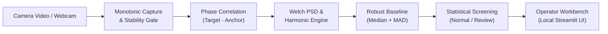

# PhaseSight Evaluator Demonstration Guide (Prasunex Innovathon 2026)

> **Estimated Walkthrough Time:** 8–10 minutes  
> **Target Audience:** Hackathon Judges, Technical Evaluators, Reliability Engineers, Workshop Operators  
> **Environment:** Python 3.13+ on macOS, Linux, or Windows (Local-First Application)

---

## Executive Overview

**PhaseSight** is a local-first software prototype that transforms ordinary video cameras into non-contact, sub-pixel vibration screening tools. By pairing phase-domain image motion estimation (OpenCV phase correlation) with stationary background cancellation (differential target-minus-anchor tracking) and Welch power spectral density, PhaseSight extracts repeatable structural vibration signatures without requiring costly accelerometer installations.



### Core Proposition & Scope Boundaries
PhaseSight is designed as an accessible **first-pass vibration screening tool**, not a replacement for calibrated multi-axis accelerometers or certified vibration analysts.
- **Pixel Units Only:** Outputs are reported strictly in image pixels. Conversion to engineering units (mm, mm/s) requires in-situ physical optical target calibration.
- **2D Planar Translation:** Compensates for in-plane camera translation; does not claim correction for camera rotation, zoom, parallax, or rolling-shutter distortion.
- **Screening, Not Fault Diagnosis:** A `Review` status indicates a measured statistical shift relative to the machine's healthy baseline, not a diagnosed bearing, gear, or unbalance fault.
- **Visual Magnification Isolated:** Riesz motion magnification is an optional post-processing visualization branch and never feeds alert logic.

---

## Prerequisites & Quickstart

### 1. Environment Verification
Open your terminal in the `PhaseSight_Validation_Kit` directory and activate the virtual environment:
```bash
cd PhaseSight_Validation_Kit
source .venv/bin/activate
```

### 2. Run Automated Regression Test Suite
Verify that all 89+ unit tests pass with zero regressions:
```bash
pytest -q
```
*Expected Output:*
```text
......................................................................................... [100%]
89 passed in ~20s
```

---

## Walkthrough Stages

---

### Stage 1: Automated Proposal Validation Matrix (CLI)

The PhaseSight validation engine implements all six verification protocols defined on **Page 5 of the Proposal**:
- **T1:** Synthetic Known Motion Recovery (Clean & Harmonic Vibration)
- **T2:** Static Negative Control & Noise Floor Quantification
- **T3:** Camera-Motion Control (Quantitative Before/After Anchor Subtraction Efficacy)
- **T4:** Portable/Physical Baseline Repeatability ($\ge 3$ captures)
- **T5:** Controlled Change Detection (Baseline vs Changed clip)
- **T6:** Image-Quality Stress Testing (Low texture, blur, flicker, dropped frames)

Execute the full proposal validation suite:
```bash
phasesight validate --json data/validation_results.json
```

*Expected Terminal Output:*
```text
================================================================================
PhaseSight Proposal Validation Matrix (T1–T6) — Innovathon 2026
================================================================================
[PASS] T1: Synthetic Known Motion Recovery
       - Clean Target (8.5 Hz):      f=8.503 Hz (err=0.003 Hz), RMSE=0.056 px, r=0.991
       - Harmonic Target (8.5+17Hz): f=8.504 Hz, RMSE=0.082 px, 2x_ratio=0.077, r=0.982
[PASS] T2: Static Negative Control & Noise Floor
       - Pure Static Scene:          RMS=0.032 px, peak=7.1 dB, qual=LOW_SIGNAL
       - Camera Shake Only (Null):   RMS=0.052 px, peak=7.1 dB, qual=LOW_SIGNAL
[PASS] T3: Camera-Motion Control (Anchor Subtraction Efficacy)
       - Uncorrected Motion:         RMSE=0.467 px, r=0.517
       - Corrected (Subtracted):     RMSE=0.132 px, r=0.914
       - Efficacy:                   71.7% error reduction (11.0 dB shake suppression)
[PASS] T4: Portable Baseline Repeatability (>=3 Captures)
       - Multi-Run Aggregation:      f=8.505 Hz (MAD=0.002), RMS=0.315 px (MAD=0.002)
       - Screening Nominal Runs:     3/3 Normal status, 0 false triggers (|z| < 3.0)
[PASS] T5: Controlled Change Detection (Baseline vs Changed)
       - Changed Clip Screening:     Status: Review (z_rms=+22.54, z_harm=+5.74)
       - Boundary Verification:      Non-diagnostic disclosure confirmed
[PASS] T6: Image-Quality Stress Testing
       - T6a Low Texture:            REJECTED by validate_rois (std=0.00 < 2.0 px)
       - T6b Severe Blur:            DEGRADED phase response -> LOW_SIGNAL
       - T6c Illumination Flicker:   CONTAMINATED flag confirmed (shared peak)
       - T6d Dropped Frames:         REJECTED_UNSTABLE confirmed (jitter=83.5%, 11 drops)
================================================================================
Overall Verdict: ALL 6 PROPOSAL VALIDATION PROTOCOLS PASSED (100%)
================================================================================
Saved full validation JSON to: data/validation_results.json
```

> **Key Quantitative Takeaways:**
> - **T1:** Frequency recovered within $0.003$ Hz of true 8.5 Hz tone ($<0.04\%$ error); $r = 0.991$.
> - **T3:** Anchor subtraction reduces camera shake displacement error by **71.7%** ($11.0$ dB noise suppression).
> - **T6:** Corrupted acquisitions (flat texture, dropped frames, optical blur) are strictly intercepted before spectral evaluation.

---

### Stage 2: Command-Line Inspection of Pre-Packaged Clips

PhaseSight includes three pre-packaged 10-second compressed clips in `data/portable/`:
1. `baseline.mp4`: Healthy motor operating condition (8.5 Hz target vibration under camera shake).
2. `changed.mp4`: Operating condition with $+48.5\%$ amplitude increase and added 2x harmonic.
3. `camera_only.mp4`: Camera shake and lighting flicker with zero target motion (negative control).

#### 1. Inspect the Baseline Clip
```bash
phasesight inspect data/portable/baseline.mp4 \
  --target 360,110,160,160 \
  --anchor 60,100,160,160 \
  --out output/demo_baseline \
  --min-frequency 1 --max-frequency 20 --nperseg 256
```
Outputs generated in `output/demo_baseline/`:
- `baseline_motion.csv`: Per-frame timestamps, target, anchor, and relative displacement traces.
- `baseline_spectrum.png`: High-resolution 2-panel plot (time series + Welch PSD).
- `baseline_summary.json`: Dominant peak (8.509 Hz), RMS displacement (0.233 px), and quality status (`VALID`).

#### 2. Compare Baseline vs. Changed Clip
```bash
phasesight compare data/portable/out_baseline/baseline_summary.json \
  data/portable/out_changed/changed_summary.json \
  --out output/compare_changed.json
```
*Expected Result:* Returns `WARNING_CHANGE` (or `ALERT_CHANGE`), reporting a $+48.5\%$ increase in pixel RMS displacement with steady frequency at 8.5 Hz.

#### 3. Compare Baseline vs. Camera-Only Null Control
```bash
phasesight compare data/portable/out_baseline/baseline_summary.json \
  data/portable/out_camera_only/camera_only_summary.json \
  --out output/compare_null.json
```
*Expected Result:* Returns `INSUFFICIENT_SIGNAL` or `CONTAMINATED`, correctly rejecting the environmental flicker clip rather than misrepresenting it as a valid machine vibration.

---

### Stage 3: Launching the Local Operator Workbench

Launch the Streamlit graphical workbench:
```bash
phasesight ui --port 8501
```
Open your browser to: **`http://localhost:8501`**

#### Workbench Layout Overview:
- **Global Sidebar:** Active Machine Asset selector (`-- None (Ad-hoc Analysis) --` or registered assets), Active Asset Details Card, and SQLite database diagnostics.
- **Tab 1: Video Inspection & Live Acquisition:** Preview videos, draw/configure ROIs with real-time texture validation, configure Welch parameters, record live webcam clips with stability cards, and run vibration analysis.
- **Tab 2: Asset Management:** Register new monitored equipment, set ROI profiles, edit machine parameters, and manage asset lifecycles.
- **Tab 3: Baseline Recording Wizard:** Guided workflow to select healthy historical runs, validate quorum ($N \ge 3$) and spatial consistency ($\pm 2$ px), compute Median + MAD statistics, and commit baselines to SQLite.
- **Tab 4: 1-to-1 Comparison:** Side-by-side comparison of any two inspection summaries.
- **Tab 5: Inspection History & Trend Exploration:** Filterable historical run catalog with status badges (🟢 Normal, 🔴 Review, 🟡 Low confidence), on-demand compressed NPZ trace exploration, and operator Review Event logging form.
- **Tab 6: About & System Boundaries:** Complete mathematical formulations, references, and non-negotiable scope boundaries.

---

### Stage 4: Asset Registration & Real-Time Texture Validation (Tab 2)

1. Click on **Tab 2 (Asset Management)**.
2. In the "Register New Monitored Asset" form:
   - **Asset Name:** `Centrifugal Pump P-101`
   - **Target ROI:** `X=360, Y=110, Width=160, Height=160` (Pump Bearing Housing)
   - **Anchor ROI:** `X=60, Y=100, Width=160, Height=160` (Rigid Concrete Base)
   - **Expected FPS:** `60.0`
   - **Nominal Speed (RPM):** `510.0` (corresponds to ~8.5 Hz fundamental)
3. Click **"Register Asset"**.
4. Observe:
   - The asset is persisted to local SQLite storage (`phasesight.db`).
   - The Global Sidebar automatically switches the active asset to `Centrifugal Pump P-101`.
   - In Tab 1, all ROI coordinates and expected FPS auto-populate without manual re-entry.

---

### Stage 5: Baseline Recording Wizard (Tab 3)

1. Click on **Tab 3 (Baseline Recording Wizard)**.
2. Select `Centrifugal Pump P-101` as the active asset.
3. In **Step 1 (Select Candidate Healthy Runs)**:
   - Ingest 3 healthy reference runs (using `data/portable/out_baseline/baseline_summary.json` or runs saved to history).
4. In **Step 2 (Validation Engine)**:
   - Observe the live quorum check passing ($N = 3 \ge 3$).
   - Observe spatial consistency validation passing ($\Delta \text{ROI} \le 2$ px).
   - Observe sampling rate consistency passing ($60.0 \pm 0.1$ Hz).
5. In **Step 3 (Statistical Aggregation Preview)**:
   - Examine the Median + MAD feature table:
     - **Dominant Frequency:** Median $8.509$ Hz ($\text{MAD} = 0.000$ Hz, Normal Bounds: $8.45$–$8.57$ Hz).
     - **RMS Displacement:** Median $0.233$ px ($\text{MAD} = 0.000$ px, Normal Bounds: $0.21$–$0.25$ px).
     - Notice the zero-MAD $\epsilon$-protection preventing division by zero.
6. In **Step 4 (Commit Baseline)**:
   - Enter baseline notes: `Commissioning baseline at nominal 510 RPM speed`.
   - Click **"Establish Statistical Baseline"**.
   - Notice the Global Sidebar updates to display: `✅ bsl_... (N=3)`.

---

### Stage 6: Live Webcam Stream & Mock Capture with Frame-Rate Stability Card (Tab 1)

1. Click on **Tab 1 (Video Inspection & Live Acquisition)**.
2. Under "Select video input source", choose **"Live Webcam Stream"**.
3. In the Acquisition Controls panel:
   - **Camera Index / Source:** Enter `mock:0` (uses deterministic virtual camera stream for testing) or an integer index (`0`, `1`) for physical hardware.
   - **Duration:** Set slider to `5.0` seconds.
   - **Target FPS:** Select `30.0` or `60.0`.
4. Click **"📸 Grab Preview Frame"**:
   - Acquires a single frame from the camera stream.
   - Displays green Target ROI and orange Anchor ROI bounding boxes overlaid on the frame.
   - Displays real-time ROI texture quality badges (`std >= 2.0 px`).
5. Click **"🔴 Record Live Capture"**:
   - Progress bar tracks live acquisition over 5.0 seconds.
   - Saves timestamped clip to `output/webcam_captures/webcam_....mp4`.
6. Inspect the **⏱️ Frame-Rate Stability Card**:
   - **Timing Status:** `🟢 STABLE`
   - **Measured FPS:** Shows true empirical $f_s = 1.0 / \text{median}(\Delta t)$ (e.g., $30.00$ Hz).
   - **Timing Jitter:** Shows $\text{std}(\Delta t) / \text{median}(\Delta t)$ ($< 5\%$).
   - **Dropped Frames:** $0$ missing frames.
   - *Note:* If an unstable camera with $>15\%$ jitter or $>3$ dropped frames is detected, the card flags `🔴 REJECTED_UNSTABLE` and automatically disables spectral analysis to protect against false vibration peaks.

---

### Stage 7: Statistical Screening & Inspection History Exploration (Tabs 1, 4 & 5)

#### 1. 1-Click Auto-Assessment Against Stored Baseline
1. In Tab 1, select sample clip `changed.mp4`.
2. Click **"Run Vibration Analysis"**.
3. Once analysis completes, view the **1-Click Auto-Assessment Card**:
   - **Screening Verdict:** `🔴 Review`
   - **Triggered Features:** `X RMS Displacement (+22.54 z)`, `X 2x Harmonic Ratio (+5.74 z)`.
   - **Mandatory Disclosure:**
     > *"A Review status indicates a measured statistical shift relative to the reference baseline, not a diagnosed machine fault or failure mode."*
4. Click **"💾 Save Run to Asset History"** to persist the run to SQLite and write compressed numerical arrays (`.npz`) to disk.

#### 2. Deep-Dive History & Trend Exploration (Tab 5)
1. Click on **Tab 5 (Inspection History & Trend Exploration)**.
2. Select `Centrifugal Pump P-101`.
3. View the historical run table showing run dates, durations, and colored status badges (`🔴 Review`, `🟢 Normal`).
4. Under "Deep-Dive Run Inspector", select the latest run:
   - PhaseSight loads displacement traces and Welch spectra on-demand from the compressed `.npz` archive.
   - Renders interactive 2-panel engineering plots (relative displacement time series and semilog Welch PSD).
5. In the **Operator Review Event Form**:
   - Select disposition status: `Review`
   - Operator ID: `Lead_Inspector_1`
   - Operator Notes: `Elevated 2x harmonic indicates probable angular misalignment. Scheduled coupling inspection during next planned downtime.`
   - Click **"Log Review Event"**.
   - Observe the event recorded in the immutable chronological audit log.

---

### Stage 8: Non-Negotiable System Boundaries & Technical Disclosures (Tab 6)

Click on **Tab 6 (About & System Boundaries)** to review the non-negotiable technical boundaries governing the PhaseSight prototype:

| Boundary | Strict Engineering Disclosure |
|---|---|
| **Pixel Units Only** | All measurements, RMS values, and baselines are strictly in image pixels. PhaseSight does not report millimetres or mm/s velocity without in-situ physical optical target calibration. |
| **2D Planar Translation** | Phase correlation tracking is based on the Fourier shift theorem for in-plane translation. Does not compensate for camera rotation, zoom, perspective changes, parallax, or rolling-shutter artifacts. |
| **Anchor Dependency** | Static anchor subtraction requires a rigid, textured background at approximately the same depth as the target. Moving anchors invalidate common-motion cancellation. |
| **Statistical Screening vs. Fault Diagnosis** | Output statuses (`Normal`, `Review`, `Low confidence`) are statistical screening shifts against the asset's healthy baseline. They do not infer specific bearing faults, gear defects, or remaining useful life (RUL). |
| **Separation of Measurement & Magnification** | Riesz motion magnification is an optional visual explanation tool. Magnified pixels never feed the quantitative measurement or alert pipeline. |

---

## Troubleshooting & FAQ

- **Q: Where is data stored?**  
  All asset records, baselines, run metadata, and review events are stored in the local SQLite database at `data/storage/phasesight.db`. Time series arrays and spectra are stored in compressed NumPy format at `data/storage/npz/runs/`.
- **Q: Can I run PhaseSight without a physical webcam?**  
  Yes! PhaseSight includes a built-in virtual device `mock:0` that generates synthetic test frames with simulated monotonic timing. Pre-packaged portable MP4 clips (`data/portable/`) also provide full offline capability.
- **Q: Port 8501 is already in use:**  
  Launch the Streamlit workbench on an alternative port: `phasesight ui --port 8502`.
- **Q: macOS Camera Permission issues:**  
  Ensure your terminal emulator has camera permissions in macOS *System Settings > Privacy & Security > Camera*, or use `mock:0` for virtual capture.
