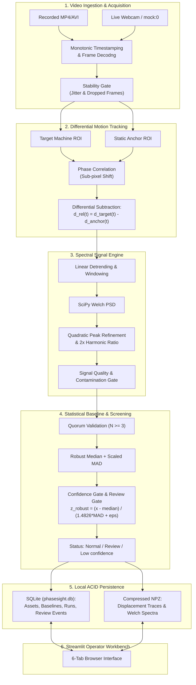

# PhaseSight — Camera-Based Vibration Screening

[](https://www.python.org/)
[](https://opensource.org/licenses/MIT)
[](tests/)
[-success.svg)](data/validation_results.json)
[](#)

> **PhaseSight** is a local-first software prototype that transforms ordinary video cameras into non-contact, sub-pixel vibration screening tools. By pairing phase-domain image motion estimation (OpenCV phase correlation) with stationary background cancellation (differential target-minus-anchor tracking) and Welch power spectral density, PhaseSight extracts repeatable structural vibration signatures without requiring costly accelerometer installations.

---

> [!IMPORTANT]
> ### Non-Negotiable Technical Boundaries & Disclosures
> 1. **Pixel-Domain Measurements Only:** All displacements, RMS amplitudes, and baselines are reported strictly in image pixels. Conversion to physical millimetres (mm) or velocity (mm/s) requires scene-scale calibration with a rigid target fiducial; no mm/s or ISO 10816/20816 severity classifications are claimed.
> 2. **2D Planar Translation Only:** Tracking uses the Fourier shift theorem for in-plane translation. PhaseSight does not compensate for out-of-plane rotation, perspective warping, zoom, camera parallax, or rolling-shutter distortion.
> 3. **Anchor Dependency:** Common camera motion cancellation requires a rigid, textured static background anchor at approximately the same optical depth as the target.
> 4. **Statistical Screening vs. Fault Diagnosis:** Output statuses (`Normal`, `Review`, `Low confidence`) reflect measured statistical shifts relative to an established machine baseline. They do not infer specific bearing, gear, or unbalance failure modes, nor do they predict Remaining Useful Life (RUL).
> 5. **Separation of Measurement and Magnification:** Riesz motion magnification is strictly an optional visual explanation branch; magnified video pixels never feed the quantitative alert or measurement pipeline.

---

## Demonstration Quickstart

For hackathon judges and evaluators, a comprehensive, step-by-step 8-stage interactive guide is available:

👉 **[Read the Full Evaluator Demonstration Guide (`DEMO_GUIDE.md`)](DEMO_GUIDE.md)** 👈

### 3-Step Verification
```bash
# 1. Activate isolated virtual environment
source .venv/bin/activate

# 2. Run the complete automated test suite (89 passing tests)
pytest -q

# 3. Execute the full Proposal Page 5 Validation Matrix (T1–T6)
phasesight validate --json data/validation_results.json

# 4. Launch the local operator workbench
phasesight ui --port 8501
```

---

## System Architecture

PhaseSight executes as a single local Python process coordinating modular processing stages:



---

## Installation & Setup

### Requirements
- **Python:** Version 3.11, 3.12, or 3.13 (Python 3.13.15 recommended)
- **Dependencies:** OpenCV (`opencv-python`), NumPy, SciPy, Matplotlib, Streamlit, pytest
- **Operating System:** macOS, Linux, or Windows

### macOS / Linux Installation
```bash
git clone https://github.com/kartikeygupta/PhaseSight_Validation_Kit.git
cd PhaseSight_Validation_Kit

python3 -m venv .venv
source .venv/bin/activate
python -m pip install --upgrade pip
python -m pip install -e '.[dev]'
```

---

## Command-Line Interface (CLI) Reference

PhaseSight provides 10 unified CLI subcommands covering validation, synthetic generation, video inspection, comparison, statistical baseline screening, local storage, live capture, and the GUI workbench.

### 1. `phasesight validate`
Executes deterministic validation suites and exports machine-readable JSON reports.
```bash
# Run full Proposal Page 5 matrix (Protocols T1 through T6)
phasesight validate --json data/validation_results.json

# Run a specific protocol (e.g. T3 Camera Shake Cancellation)
phasesight validate --test T3 --json data/t3.json

# Run legacy 4-case synthetic validation suite
phasesight validate --legacy --json data/legacy_results.json
```

### 2. `phasesight inspect`
Measures target-minus-anchor relative vibration from a video clip.
```bash
phasesight inspect data/portable/baseline.mp4 \
  --target 360,110,160,160 \
  --anchor 60,100,160,160 \
  --out output/baseline \
  --min-frequency 1.0 --max-frequency 20.0 --nperseg 256
```
*Outputs:* `*_motion.csv` (time series), `*_spectrum.png` (plot), `*_summary.json` (features & quality).

### 3. `phasesight compare`
Compares two inspection summaries using baseline comparison rules.
```bash
phasesight compare data/portable/out_baseline/baseline_summary.json \
  data/portable/out_changed/changed_summary.json \
  --axis x --out output/compare.json
```

### 4. `phasesight build-baseline`
Aggregates $\ge 3$ healthy inspection runs into an immutable statistical `BaselineRecord` using Median and scaled MAD ($1.4826 \times \text{MAD} + \epsilon$).
```bash
phasesight build-baseline run1.json run2.json run3.json \
  --asset-id "pump_101" --out baseline_pump.json
```

### 5. `phasesight assess`
Screens an inspection summary against a statistical baseline with confidence and review gates.
```bash
phasesight assess current_summary.json baseline_pump.json \
  --axis x --threshold 3.0
```

### 6. `phasesight capture`
Acquires fixed-duration live video clips with monotonic wall-clock timestamping and evaluates frame-rate stability.
```bash
# Physical camera capture (index 0)
phasesight capture 0 --duration 5.0 --target-fps 30.0 --out output/webcam.mp4

# Virtual deterministic mock capture for CI/CD
phasesight capture mock:0 --duration 3.0 --target-fps 30.0 --out output/mock.mp4
```

### 7. `phasesight asset`
Inspects and manages monitored equipment in the SQLite database.
```bash
# List all registered assets
phasesight asset list

# Create a new asset profile
phasesight asset create "Cooling Fan 4" \
  --target 200,150,120,120 --anchor 50,50,100,100 --fps 60.0 --rpm 1750.0

# Display asset details and established baselines
phasesight asset show ast_xxxxxx
```

### 8. `phasesight db-info`
Displays storage diagnostics, schema version, and database statistics.
```bash
phasesight db-info
```

### 9. `phasesight generate-synthetic`
Creates deterministic synthetic test clips with known sub-pixel motion, camera shake, flicker, and noise.
```bash
phasesight generate-synthetic data/generated/test.mp4 \
  --frequency 8.5 --amplitude 0.35 --camera-shake 0.65 --noise 1.5 --seed 42
```

### 10. `phasesight ui`
Launches the local Streamlit operator workbench.
```bash
phasesight ui --port 8501
```

---

## Local Operator Workbench (Streamlit GUI)

The workbench (`phasesight/app.py`) provides an intuitive, asset-centric interface across 6 dedicated tabs:

1. **Tab 1: Video Inspection & Live Acquisition:**
   - Source selection: Pre-packaged portable clips, custom video upload, or Live Webcam Stream (`mock:0` or hardware index).
   - Live camera preview frame grabber with green Target ROI and orange Anchor ROI overlay.
   - Real-time texture validation badge ($\text{std} \ge 2.0$ px).
   - Monotonic live recording with progress bar and **⏱️ Frame-Rate Stability Card** (`STABLE`, `WARNING_JITTER`, `REJECTED_UNSTABLE`).
   - 1-Click Auto-Assessment Card with robust z-score deviation display and mandatory non-diagnostic disclosures.
   - "Save Run to Asset History" persisting SQLite records and compressed NPZ arrays.
2. **Tab 2: Asset Management & ROI Profiles:**
   - Catalog table of registered equipment with coordinates, expected frame rates, and nominal speeds.
   - Asset registration form with "📋 Copy ROIs from Current Inspection" shortcut.
   - Parameter editor and cascading safe deletion.
3. **Tab 3: Baseline Recording Wizard:**
   - Guided workflow enforcing quorum ($N \ge 3$), spatial ROI consistency ($\pm 2$ px), and frame-rate consistency ($\pm 2\%$).
   - Live Median + MAD feature table preview with zero-MAD $\epsilon$-protection.
   - Commit baseline to SQLite and NPZ storage.
4. **Tab 4: 1-to-1 Comparison:**
   - Side-by-side comparative inspection between reference baseline and current run.
5. **Tab 5: Inspection History & Trend Exploration:**
   - Filterable historical run catalog with status badges (🟢 Normal, 🔴 Review, 🟡 Low confidence).
   - On-demand NPZ array loading with 2-panel interactive Matplotlib engineering plots.
   - Operator Review Event logging form with immutable chronological audit trail.
6. **Tab 6: About & System Boundaries:**
   - Technical disclosures, mathematical formulations, and engineering boundaries.

---

## Automated Test Suite

PhaseSight features an exhaustive automated test suite with **89 passing tests** across 9 modules:

```bash
pytest -v
```

| Test Module | Tests | Scope & Capabilities Verified |
|---|---:|---|
| `tests/test_tracker.py` | 7 | Sub-pixel phase correlation, anchor subtraction, reference patch immutability, ROI bounds, texture thresholding. |
| `tests/test_analysis.py` | 10 | Welch PSD, quadratic peak interpolation, harmonic ratio, low-signal rejection, anchor contamination, timestamp monotonicity. |
| `tests/test_video_pipeline.py` | 2 | End-to-end MP4 decode/encode round-trip, portable clip analysis, quality gating. |
| `tests/test_baseline.py` | 16 | Multi-run aggregation, Median + MAD, scaled MAD ($1.4826 \times \text{MAD} + \epsilon$), robust z-scores, quorum rules, spatial ROI matching. |
| `tests/test_storage.py` | 15 | SQLite schema migrations, foreign key cascades, thread-safe RLock, asset/baseline/run/review CRUD, compressed NPZ storage. |
| `tests/test_capture.py` | 13 | Monotonic timing (`time.perf_counter()`), empirical FPS, timing jitter, dropped frame detection, `MockVideoCapture`, CLI capture. |
| `tests/test_ui.py` | 15 | Headless `AppTest` for tabs 1-5, asset selector synchronization, baseline wizard, mock live capture, stability card gating. |
| `tests/test_validation_suite.py` | 1 | 4-case legacy synthetic validation suite backward compatibility. |
| `tests/test_validation_matrix.py` | 10 | Proposal Page 5 matrix (T1 through T6) and CLI validation flag integration. |
| **Total** | **89** | **100% Pass Rate across all modules with zero regressions.** |

---

## Public Benchmark Datasets & Physical Testing

PhaseSight's software and numerical pipeline has been independently validated using deterministic synthetic scenes with exact mathematical ground truth. To evaluate physical cameras and physical machine vibration:

1. **Mendeley High-Speed Rotor Video Dataset:**  
   Synchronized 500 FPS video and 1 kHz eddy-current displacement sensor data of a rotating machine rig under healthy and unbalance conditions.  
   *URL:* [https://data.mendeley.com/datasets/47y7rwc2yg/1](https://data.mendeley.com/datasets/47y7rwc2yg/1) (DOI: 10.17632/47y7rwc2yg.1)  
   *Protocol:* Run `phasesight inspect <video.mp4> --fps 500.0` and compare computed Welch PSD against sensor CSV PSD.
2. **DMD Lab Structural Motion Dataset:**  
   240 FPS high-speed video of a vibrating laboratory structure with accelerometer ground truth.  
   *URL:* [https://zenodo.org/records/18021913](https://zenodo.org/records/18021913)
3. **MIT CSAIL Phase-Based Video Motion Processing:**  
   Benchmark video sequences for sub-pixel motion extraction and phase processing.  
   *URL:* [https://people.csail.mit.edu/nwadhwa/phase-video/](https://people.csail.mit.edu/nwadhwa/phase-video/)

---

## Technical References

1. Wadhwa, N., Rubinstein, M., Durand, F. and Freeman, W. T. (2013). *"Phase-Based Video Motion Processing."* ACM Transactions on Graphics, 32(4), Article 80.
2. Wadhwa, N., Rubinstein, M., Durand, F. and Freeman, W. T. (2014). *"Riesz Pyramids for Fast Phase-Based Video Magnification."* IEEE Conference on Computer Vision and Pattern Recognition (CVPR).
3. OpenCV Documentation (4.x). *"Motion Analysis and Object Tracking: phaseCorrelate."* https://docs.opencv.org/4.x/d7/df3/group__imgproc__motion.html
4. SciPy Documentation. *"scipy.signal.welch: Power spectral density using Welch's method."* https://docs.scipy.org/doc/scipy/reference/generated/scipy.signal.welch.html

---

## License
MIT License. Developed for the **Prasunex Innovathon 2026 (Round 2)**.
