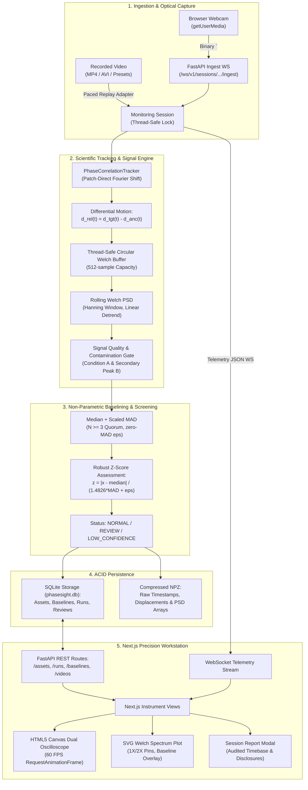
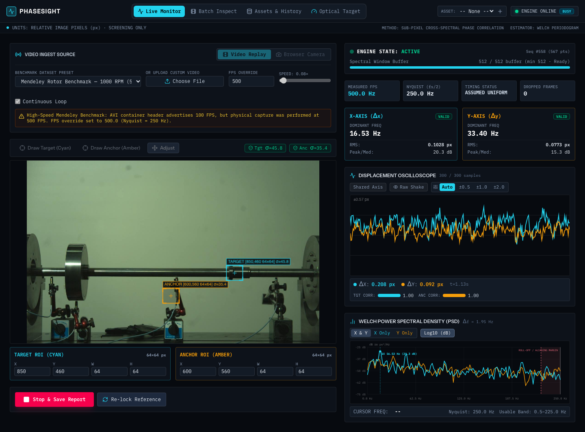
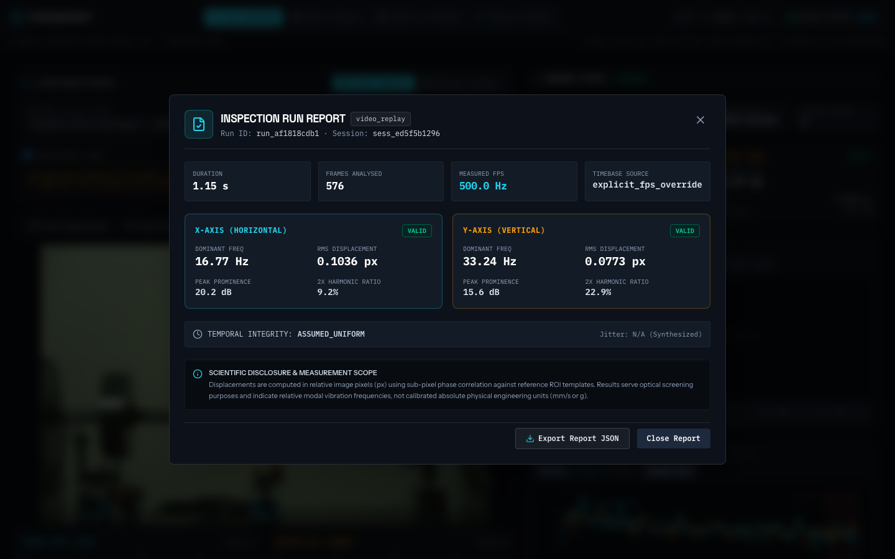
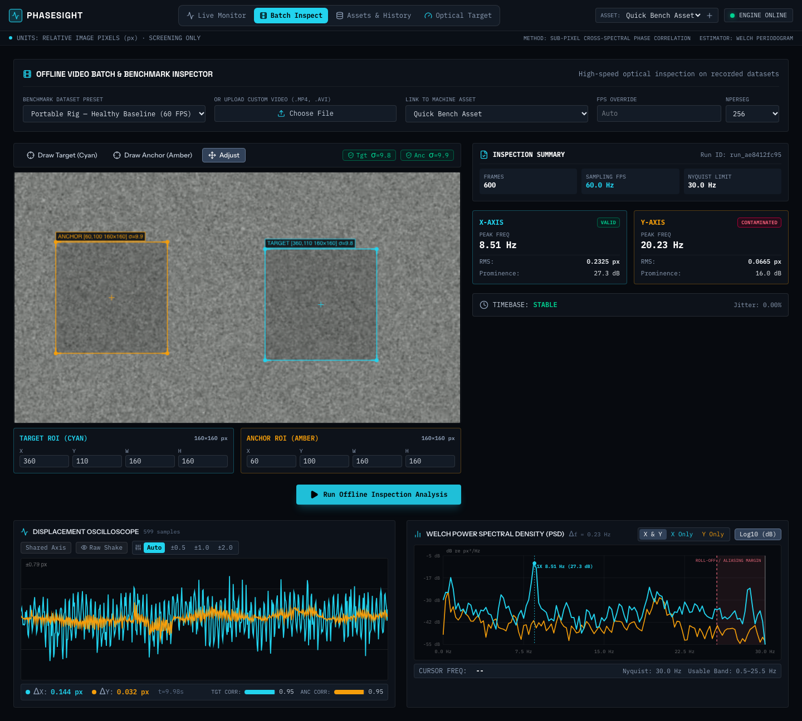
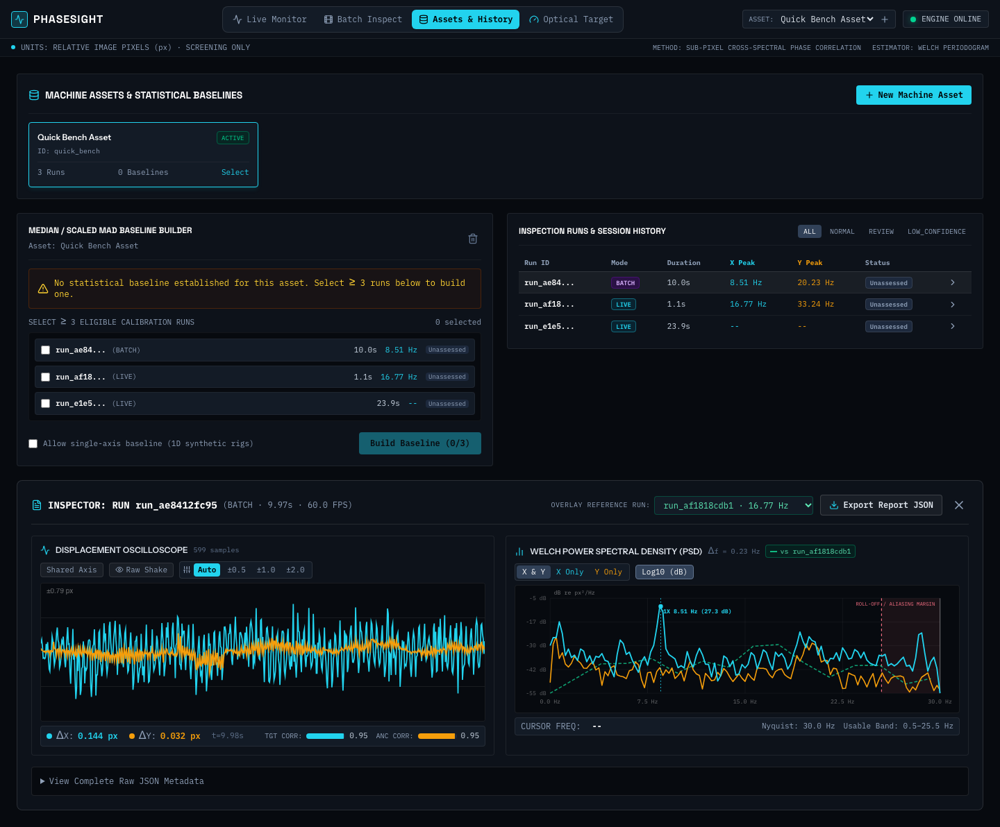

# PhaseSight — Precision Optical Vibration Screening Workstation

[](https://www.python.org/)
[](https://opensource.org/licenses/MIT)
[](tests/)
[](backend/)
[](frontend/)
[-success.svg)](data/validation_results.json)
[](#)

> **PhaseSight** is a precision, local-first industrial monitoring engine and spectral workstation that transforms ordinary video cameras and high-speed sensors into sub-pixel optical vibration screening instruments. By combining phase-domain Fourier shift estimation (`cv2.phaseCorrelate`) with differential stationary anchor subtraction ($\Delta d(t) = d_{\text{target}}(t) - d_{\text{anchor}}(t)$), rolling Welch power spectral density, and robust median/scaled-MAD baselining, PhaseSight isolates machine vibration signatures from ambient optical sway and tripod jitter without requiring invasive contact accelerometers.

---

> [!IMPORTANT]
> ### Non-Negotiable Technical Boundaries & Disclosures
> 1. **Relative Pixel Measurements Only:** All displacements, RMS amplitudes, and baselines are reported strictly in relative image pixels (`px`). Physical millimetre (`mm`) or velocity (`mm/s`) conversion requires rigid coplanar fiducial calibration; PhaseSight intentionally claims **no** ISO 10816/20816 severity classifications without external physical scaling.
> 2. **Planar Translation Geometry:** Sub-pixel motion estimation relies on the Fourier shift theorem for 2D rigid in-plane translation. Out-of-plane rotation, perspective warping, zoom, optical parallax, and rolling-shutter artifacts are rejected by quality and texture gates.
> 3. **Stationary Background Anchor Requirement:** Optical camera shake cancellation requires a rigid, static background anchor located at approximately the same optical depth as the target region of interest (ROI).
> 4. **Statistical Anomaly Screening vs. Diagnostic Teardown:** Status determinations (`Normal`, `Review`, `Low Confidence`) reflect non-parametric statistical deviation ($Z_{\text{robust}} > 3.0$) against established healthy baselines. They indicate that vibration characteristics have significantly altered; they do not infer specific bearing raceway defects, gear tooth pitting, or predict Remaining Useful Life (RUL).
> 5. **Separation of Measurement and Magnification:** Riesz video motion magnification operates strictly as an optional human visual verification aid; magnified pixels never feed into the numerical alerting or baseline assessment pipeline.

---

## Quickstart & Launch Options

### 1. Unified Precision Workstation (Next.js + FastAPI)
Launch the complete modern stack (FastAPI backend on port 8000 and Next.js workstation on port 3000) with one command:
```bash
./scripts/dev.sh
```
Open **[http://localhost:3000](http://localhost:3000)** in your browser to access the "Spectral Observatory" workstation.

### 2. Automated Test Suite (139 Passing Tests)
Run the full pytest suite verifying the scientific core, monitoring engine, and REST/WebSocket backend:
```bash
.venv/bin/python -m pytest tests/ -q
```

### 3. Live End-to-End Verification Scripts
Verify continuous streaming, pacing, baseline building, and review evaluation:
```bash
# Verify backend WebSocket & REST pipelines
.venv/bin/python scripts/test_live_e2e.py

# Verify browser UI, getUserMedia webcam streaming, /target calibrator, and screenshot captures
.venv/bin/python scripts/test_browser_ui.py
```

---

## Sampling Rate & Nyquist Feasibility Matrix

The fundamental physical constraint of optical vibration monitoring is the Shannon-Nyquist sampling theorem ($f_{\text{Nyquist}} = f_s / 2$). In `phasesight/analysis.py`, PhaseSight enforces a default analytical upper cutoff ($f_{\text{usable}} = 0.90 \times f_{\text{Nyquist}}$, capped at $0.95 \times f_{\text{Nyquist}}$) to prevent high-frequency aliasing and roll-off distortion.

| Camera / Source Class | Sampling Rate ($f_s$) | Nyquist Limit ($f_{\text{Nyquist}}$) | `0.90×` Cutoff | Measurable Machinery & Screening Scope |
|---|---|---|---|---|
| **Standard USB Webcam** | 15–30 FPS | 7.5–15.0 Hz | 6.75–13.5 Hz | Low-speed machinery: Agitators, clarifiers, conveyor drives, structural building/bridge sway, cooling tower fans (<750 RPM 1X). |
| **Industrial / 60 FPS Webcam** | 60 FPS | 30.0 Hz | 27.0 Hz | Standard industrial electric motors (1X unbalance up to ~1,440 RPM / ~24 Hz, centrifugal pumps, gearboxes safely below Nyquist). |
| **High-Rate Machine Vision** | 120–240 FPS | 60.0–120.0 Hz | 54.0–108.0 Hz | 2-pole 3600 RPM motors (60 Hz 1X) & 2X harmonics up to ~100 Hz (3000 RPM), high-speed blower fans, positive displacement compressors. |
| **High-Speed Sensor Video** *(e.g. Mendeley Rotor Benchmark)* | 500 FPS | 250.0 Hz | 225.0 Hz | Rotor test rigs, turbomachinery unbalance dynamics ($1000\text{--}3000\text{ RPM}$, $1\text{X} \approx 16.5\text{--}50\text{ Hz}$), blade pass fundamentals, harmonics through $4\text{X}$. |

---

## System Architecture



---

## Verified E2E Workflow Verification & Screenshots

The complete workstation has been verified under real browser automation using Playwright (`scripts/test_browser_ui.py`) with Chromium fake-camera devices, zero uncaught page errors, and zero HTTP 500 responses:

| Workflow View | Screenshot | Verified Functionality |
|---|---|---|
| **1. Live Monitor (Active Tracking)** |  | 500 FPS Mendeley Rotor replay (`rotor_1000rpm_unb1`), Welch warm-up buffer progress, active state, live oscilloscope, 16.5 Hz 1X spectral peak. |
| **2. Inspection Run Report Modal** |  | Monotonic duration audit, non-zero measured FPS, X/Y RMS amplitudes, prominence (dB), harmonic ratios, timebase source disclosures. |
| **3. Batch & Benchmark Inspector** |  | Offline video processing on `portable_baseline`, Nyquist limits, Welch PSD plot with logarithmic scaling, temporal stability metrics. |
| **4. Machine Assets & History Drawer** |  | Asset catalog, statistical baseline summary with scaled MAD tolerances, historical run table, interactive run inspector drawer. |

---

## Directory Structure

```
PhaseSight_Validation_Kit/
├── backend/                       # FastAPI REST API & WebSocket Services
│   ├── main.py                    # App entrypoint, CORS, exception handlers
│   ├── manager.py                 # Thread-safe MonitoringManager, session lifecycle
│   ├── presets.py                 # Allowlisted video presets discovery
│   ├── schemas.py                 # Pydantic v2 schemas, NaN/Inf sanitization
│   ├── ws.py                      # Binary ROI ingest & JSON telemetry WebSocket endpoints
│   └── routes/                    # REST modular route controllers
│       ├── assets.py              # Equipment catalog & baseline management
│       ├── baselines.py           # Statistical baseline calculation & quorum checks
│       ├── health.py              # System health, memory, active session status
│       ├── runs.py                # Inspection run queries, NPZ loading, batch analysis
│       ├── sessions.py            # Monitoring session start, stop, recalibrate, MJPEG
│       └── videos.py              # Video preview frame extraction, ROI texture verification
├── frontend/                      # Next.js 16 Precision Workstation Frontend
│   ├── src/
│   │   ├── app/                   # App Router layout, workstation page & /target bench
│   │   │   ├── page.tsx           # Main Precision Workstation shell
│   │   │   └── target/page.tsx    # Dark-ground anti-overexposure optical calibrator (/target)
│   │   ├── components/            # Precision instrument components
│   │   │   ├── AppShell.tsx       # Header, navigation, asset selector, health badge
│   │   │   ├── AssetsHistoryView.tsx # Asset catalog, baseline wizard, run inspector
│   │   │   ├── BatchInspectView.tsx  # Offline batch video processing & benchmark suite
│   │   │   ├── LiveMonitorView.tsx   # Live camera/replay monitor, controls, telemetry
│   │   │   ├── OscilloscopeCanvas.tsx# 60 FPS HTML5 canvas oscilloscope with split mode
│   │   │   ├── RoiInteractiveCanvas.tsx # Interactive ROI bounding box editor with live texture std
│   │   │   ├── SessionReportModal.tsx# Formatted ISO inspection report with disclosures
│   │   │   └── SpectrumPlot.tsx   # SVG Welch power spectrum with 1X/2X callouts
│   │   └── lib/                   # API clients, WebSocket hooks, WebRTC/webcam streamers
│   │       ├── api.ts             # Typed REST API client
│   │       ├── config.ts          # API/WS base URL configuration
│   │       ├── types.ts           # Shared TypeScript domain contracts
│   │       ├── useTelemetrySocket.ts # WebSocket telemetry receiver & normalizer
│   │       └── webcamStreamer.ts  # getUserMedia capture & binary `<dIHHHHI` sender
├── phasesight/                    # Core Python Scientific Engine
│   ├── tracker.py                 # PhaseCorrelationTracker, ROI validation, texture std check
│   ├── analysis.py                # Welch PSD, quadratic peak interpolation, contamination checks
│   ├── baseline.py                # Median + MAD calculation, robust Z-score evaluation
│   ├── storage.py                 # SQLite storage engine, ACID transactions, NPZ arrays
│   ├── capture.py                 # Video capture, mock capture, frame-rate jitter metrics
│   ├── video.py                   # High-performance video decoding & frame iteration
│   └── monitoring/                # Continuous Monitoring Subsystem
│       ├── session.py             # MonitoringSession orchestration, report persistence
│       ├── ring_buffer.py         # Thread-safe ring buffer for streaming samples
│       ├── rolling_analysis.py    # Rolling Welch analysis, timing & WARMING_UP gating
│       └── replay_adapter.py      # PacedVideoReplayAdapter for real-time video playback
├── docs/                          # Technical reports, architecture spec & Round 3 PDF
├── scripts/
│   ├── dev.sh                     # Unified local development launcher
│   ├── reset_demo_db.py           # Clean Round 3 demo asset & baseline seeder
│   ├── build_round3_pdf.py        # Headless Chromium PDF submission report generator
│   ├── test_live_e2e.py           # Comprehensive backend REST & WebSocket verification
│   └── test_browser_ui.py         # Playwright Chromium headless UI verification
├── tests/                         # 139 Automated Pytest Tests across 10 modules
└── reports/e2e_screenshots/       # Automated browser verification screenshot captures
```

---

## Technical References

1. Wadhwa, N., Rubinstein, M., Durand, F. and Freeman, W. T. (2013). *"Phase-Based Video Motion Processing."* ACM Transactions on Graphics, 32(4), Article 80.
2. OpenCV Documentation (4.x). *"Motion Analysis and Object Tracking: phaseCorrelate."* [https://docs.opencv.org/4.x/d7/df3/group__imgproc__motion.html](https://docs.opencv.org/4.x/d7/df3/group__imgproc__motion.html)
3. SciPy Documentation. *"scipy.signal.welch: Power spectral density using Welch's method."* [https://docs.scipy.org/doc/scipy/reference/generated/scipy.signal.welch.html](https://docs.scipy.org/doc/scipy/reference/generated/scipy.signal.welch.html)
4. Mendeley High-Speed Rotor Video Dataset. [https://data.mendeley.com/datasets/47y7rwc2yg/1](https://data.mendeley.com/datasets/47y7rwc2yg/1) (DOI: 10.17632/47y7rwc2yg.1)

---

## License & Setup
MIT License. Developed for the **Prasunex Innovathon 2026 (Round 3)**.
```bash
git clone https://github.com/Kartikey-97/PhaseSight.git
cd PhaseSight

python3 -m venv .venv
source .venv/bin/activate
python -m pip install --upgrade pip
python -m pip install -e '.[dev]'
```

---

## Command-Line Interface (CLI) Reference

PhaseSight provides 9 unified CLI subcommands covering validation, synthetic generation, video inspection, comparison, statistical baseline screening, local storage, and live capture.

### 1. `phasesight validate`
Executes deterministic validation suites and exports machine-readable JSON reports.
```bash
# Run full Proposal Page 5 matrix (Protocols T1 through T6)
phasesight validate --json data/validation_results.json

# Run a specific protocol (e.g. T3 Camera Shake Cancellation)
phasesight validate --test T3 --json data/t3.json

# Run legacy 4-case synthetic validation suite
phasesight validate --legacy --json data/legacy_results.json
```

### 2. `phasesight inspect`
Measures target-minus-anchor relative vibration from a video clip.
```bash
phasesight inspect data/portable/baseline.mp4 \
  --target 360,110,160,160 \
  --anchor 60,100,160,160 \
  --out output/baseline \
  --min-frequency 1.0 --max-frequency 20.0 --nperseg 256
```
*Outputs:* `*_motion.csv` (time series), `*_spectrum.png` (plot), `*_summary.json` (features & quality).

### 3. `phasesight compare`
Compares two inspection summaries using baseline comparison rules.
```bash
phasesight compare data/portable/out_baseline/baseline_summary.json \
  data/portable/out_changed/changed_summary.json \
  --axis x --out output/compare.json
```

### 4. `phasesight build-baseline`
Aggregates $\ge 3$ healthy inspection runs into an immutable statistical `BaselineRecord` using Median and scaled MAD ($1.4826 \times \text{MAD} + \epsilon$).
```bash
phasesight build-baseline run1.json run2.json run3.json \
  --asset-id "pump_101" --out baseline_pump.json
```

### 5. `phasesight assess`
Screens an inspection summary against a statistical baseline with confidence and review gates.
```bash
phasesight assess current_summary.json baseline_pump.json \
  --axis x --threshold 3.0
```

### 6. `phasesight capture`
Acquires fixed-duration live video clips with monotonic wall-clock timestamping and evaluates frame-rate stability.
```bash
# Physical camera capture (index 0)
phasesight capture 0 --duration 5.0 --target-fps 30.0 --out output/webcam.mp4

# Virtual deterministic mock capture for CI/CD
phasesight capture mock:0 --duration 3.0 --target-fps 30.0 --out output/mock.mp4
```

### 7. `phasesight asset`
Inspects and manages monitored equipment in the SQLite database.
```bash
# List all registered assets
phasesight asset list

# Create a new asset profile
phasesight asset create "Cooling Fan 4" \
  --target 200,150,120,120 --anchor 50,50,100,100 --fps 60.0 --rpm 1750.0

# Display asset details and established baselines
phasesight asset show ast_xxxxxx
```

### 8. `phasesight db-info`
Displays storage diagnostics, schema version, and database statistics.
```bash
phasesight db-info
```

### 9. `phasesight generate-synthetic`
Creates deterministic synthetic test clips with known sub-pixel motion, camera shake, flicker, and noise.
```bash
phasesight generate-synthetic data/generated/test.mp4 \
  --frequency 8.5 --amplitude 0.35 --camera-shake 0.65 --noise 1.5 --seed 42
```

## Automated Test Suite

PhaseSight features an automated test suite with **139 passing tests** across 10 modules:

```bash
.venv/bin/python -m pytest tests/ -v
```

| Test Module | Tests | Scope & Capabilities Verified |
|---|---:|---|
| `tests/test_tracker.py` | 19 | Sub-pixel phase correlation, patch-direct tracker (`from_patches`), anchor subtraction, reference patch immutability, ROI bounds, texture thresholding. |
| `tests/test_analysis.py` | 22 | Welch PSD, quadratic peak interpolation, harmonic ratio, low-signal rejection, DEF-01 anchor contamination (Condition A & secondary peak B), timestamp monotonicity. |
| `tests/test_video_pipeline.py` | 15 | End-to-end MP4 decode/encode round-trip, portable clip analysis, FPS override provenance, quality gating. |
| `tests/test_baseline.py` | 23 | Multi-run aggregation, Median + MAD, scaled MAD ($1.4826 \times \text{MAD} + \epsilon$), robust z-scores, quorum rules, spatial ROI matching, `require_valid_axes` enforcement. |
| `tests/test_storage.py` | 15 | SQLite schema migrations, foreign key cascades, thread-safe RLock, asset/baseline/run/review CRUD, compressed NPZ storage. |
| `tests/test_capture.py` | 13 | Monotonic timing (`time.perf_counter()`), empirical FPS, timing jitter, dropped frame detection, `MockVideoCapture`, CLI capture. |
| `tests/test_validation_suite.py` | 1 | 4-case legacy synthetic validation suite backward compatibility. |
| `tests/test_validation_matrix.py` | 10 | Proposal Page 5 matrix (T1 through T6) and CLI validation flag integration. |
| `tests/test_monitoring.py` | 11 | Thread-safe circular ring buffer, continuous monitoring engine, paced video replay adapter, rolling Welch warm-up & timing gates. |
| `tests/test_api.py` | 10 | FastAPI REST service routes (`/health`, `/assets`, `/runs`, `/baselines`, `/videos`, `/sessions`), binary `<dIHHHHI` WebSocket ingest & telemetry, custom video upload, `browser_media_time` enforcement. |
| **Total** | **139** | **100% Pass Rate across all modules with zero regressions.** |

---

## Public Benchmark Datasets & Physical Testing

PhaseSight's software and numerical pipeline has been independently validated using deterministic synthetic scenes with exact mathematical ground truth. To evaluate physical cameras and physical machine vibration:

1. **Mendeley High-Speed Rotor Video Dataset:**  
   Synchronized 500 FPS video and 1 kHz eddy-current displacement sensor data of a rotating machine rig under healthy and unbalance conditions.  
   *URL:* [https://data.mendeley.com/datasets/47y7rwc2yg/1](https://data.mendeley.com/datasets/47y7rwc2yg/1) (DOI: 10.17632/47y7rwc2yg.1)  
   *Protocol:* Run `phasesight inspect <video.mp4> --fps 500.0` and compare computed Welch PSD against sensor CSV PSD.
2. **DMD Lab Structural Motion Dataset:**  
   240 FPS high-speed video of a vibrating laboratory structure with accelerometer ground truth.  
   *URL:* [https://zenodo.org/records/18021913](https://zenodo.org/records/18021913)
3. **MIT CSAIL Phase-Based Video Motion Processing:**  
   Benchmark video sequences for sub-pixel motion extraction and phase processing.  
   *URL:* [https://people.csail.mit.edu/nwadhwa/phase-video/](https://people.csail.mit.edu/nwadhwa/phase-video/)

---

## Technical References

1. Wadhwa, N., Rubinstein, M., Durand, F. and Freeman, W. T. (2013). *"Phase-Based Video Motion Processing."* ACM Transactions on Graphics, 32(4), Article 80.
2. Wadhwa, N., Rubinstein, M., Durand, F. and Freeman, W. T. (2014). *"Riesz Pyramids for Fast Phase-Based Video Magnification."* IEEE Conference on Computer Vision and Pattern Recognition (CVPR).
3. OpenCV Documentation (4.x). *"Motion Analysis and Object Tracking: phaseCorrelate."* https://docs.opencv.org/4.x/d7/df3/group__imgproc__motion.html
4. SciPy Documentation. *"scipy.signal.welch: Power spectral density using Welch's method."* https://docs.scipy.org/doc/scipy/reference/generated/scipy.signal.welch.html

---

## License
MIT License. Developed for the **Prasunex Innovathon 2026 (Round 3)**.
