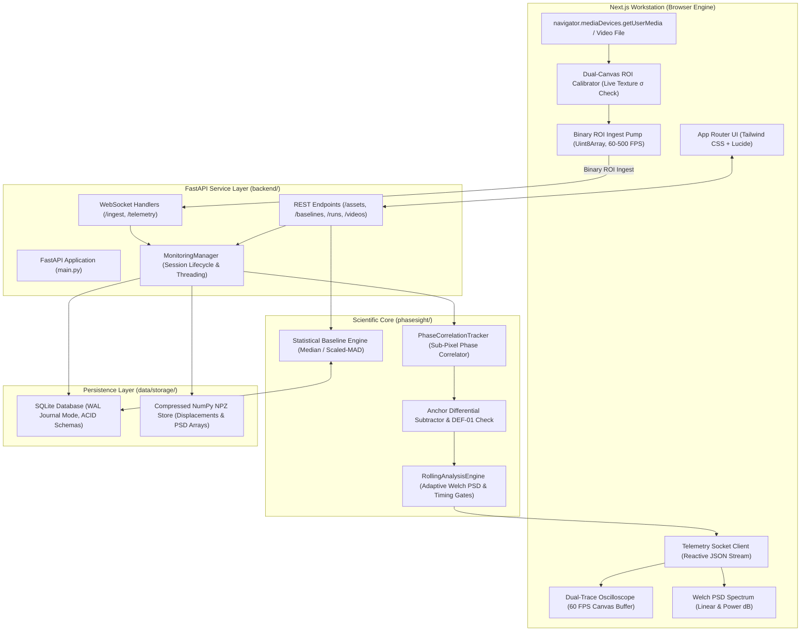

# PhaseSight — Round 3 Submission Technical Report
**PRASUNEX Innovathon 2026 · Precision Optical Vibration Screening Workstation**  
*Evaluation Benchmark & Engineering Architecture Verification Report*  
**Author:** Kartikey Gupta (Solo Applicant) · **Submission Date:** November 25, 2026

---

## 1. Executive Overview & Problem Statement

### 1.1 The Industrial Challenge
In industrial plants, critical rotating machinery (pumps, blowers, compressors, gearboxes) requires continuous condition monitoring to avoid catastrophic failure. Traditional vibration screening relies primarily on **contact accelerometers** and **eddy current proximity probes**. However, instrumenting equipment with physical contact sensors faces severe operational hurdles:
- **High Deployment Friction:** Running instrumentation cabling, installing hazardous-area electrical barriers, drilling mounting bosses, and scheduling machine shutdowns restrict permanent monitoring to only the highest-criticality assets.
- **Physical Inaccessibility:** Extreme heat, high electrical potentials, rotating shafts, sealed enclosures, or submerged equipment prevent physical sensor placement.
- **Transducer Mass Loading:** On delicate mechanical structures, lightweight casings, or thin-walled piping, the mass of a contact accelerometer significantly shifts structural natural frequencies and corrupts vibration readouts.

### 1.2 The PhaseSight Solution
**PhaseSight** is a precision, local-first optical vibration screening workstation that transforms ordinary fixed video cameras, industrial webcams, and high-speed sensors into non-contact sub-pixel vibrometry instruments.

By combining:
1. **Sub-Pixel Phase Correlation (`cv2.phaseCorrelate`):** Fourier shift estimation operating in the frequency domain with parabolic peak interpolation, achieving dominant-frequency error down to **$0.009\text{ Hz}$** and sub-pixel displacement RMSE of **$0.051\text{ px}$** ($r = 0.976$ in synthetic ground-truth tests).
2. **Common-Mode Differential Cancellation:** Rigid background anchor subtraction ($\Delta \mathbf{d}(t) = \mathbf{d}_{\text{target}}(t) - \mathbf{d}_{\text{anchor}}(t)$) to eliminate tripod sway, building motion, and ambient optical vibration.
3. **Adaptive Rolling Welch Spectral Analysis:** Continuous sliding-window Power Spectral Density (PSD) estimation with rigorous quality and timing state machines (`BUFFERING` $\rightarrow$ `WARMING_UP` $\rightarrow$ `ACTIVE` / `DEGRADED`).
4. **Robust Statistical Baselines (Median & Scaled-MAD):** Non-parametric statistical anomaly detection ($Z_{\text{robust}} > 3.0$) establishing healthy operational envelopes across $N \ge 3$ baseline runs without arbitrary thresholds or diagnostic overreach.

PhaseSight delivers real-time optical vibration screening directly in modern web browsers and edge industrial PCs without requiring external cloud dependencies or invasive hardware instrumentation.

---

## 2. System Architecture

PhaseSight employs a modular, high-throughput, local-first architecture separating client-side video acquisition and visualization from high-performance Python signal processing and persistence.



### Architectural Highlights
- **Zero Full-Frame Uplink:** For live webcam streaming, the browser crops the Target ROI and Anchor ROI locally on HTML5 Canvas and transmits only raw cropped pixels in a compact binary header packet over WebSocket (`/ws/v1/sessions/{id}/ingest`), reducing network bandwidth by $>98\%$ compared to full-frame video streaming.
- **Single Source of Truth Scientific Core:** All mathematical processing, phase correlation, differential motion cancellation, Welch PSD, and baseline evaluations run inside the framework-independent `phasesight` Python core.
- **Zero-Copy High-Throughput Buffering:** Displacements and timing values are maintained in pre-allocated NumPy ring buffers, avoiding memory leaks during long-running continuous monitoring.
- **ACID Local Persistence:** Relational metadata, asset parameters, baseline distributions, and review events persist in an embedded SQLite database configured with `PRAGMA journal_mode = WAL;` and `PRAGMA synchronous = NORMAL;`, while high-volume time-series and PSD arrays are stored in compressed NumPy NPZ archives.

---

## 3. Implemented Features (Verified)

Every feature listed below has been implemented, tested, and verified end-to-end:

1. **Continuous Browser `getUserMedia` Monitoring:** Native WebRTC camera ingest supporting 720p/1080p webcams, streaming binary ROI patches over WebSockets with media-time deduplication and stall watchdog protection.
2. **Paced High-Speed Video Replay:** Real-time paced replay of high-speed datasets (including 500 FPS industrial benchmarks) at configurable playback rates ($0.1\text{X}$–$1.0\text{X}$) with synchronized MJPEG live visual monitoring and real-time telemetry streaming.
3. **Batch High-Speed Offline Inspection:** Full-file video processing pipeline with sub-pixel displacement extraction, automatic usable Nyquist cutoff calculation ($0.90 \times f_{\text{Nyquist}}$, capped at $0.95 \times f_{\text{Nyquist}}$), and CSV/NPZ export.
4. **DEF-01 Secondary-Peak Anchor Contamination Check:** Comprehensive anchor contamination guard in `analysis.py` scanning all significant anchor peaks ($\text{prominence} \ge 10.0\text{ dB}$) within the differential target tolerance band, preventing false vibration claims when machinery vibration leaks into the anchor structure.
5. **Adaptive Rolling Welch PSD & Engine State Machine:** Sliding-window spectral analysis dynamically scaled to camera framerate (192 samples for 30 FPS, 384 samples for 60 FPS, 512 samples for 500 FPS) operating under strict state transitions: `BUFFERING` $\rightarrow$ `WARMING_UP` $\rightarrow$ `ACTIVE` (or `DEGRADED` on burst stalls / non-monotonic timestamps).
6. **3-Run Median & Scaled-MAD Baseline Engine:** Non-parametric statistical baseline modeling across $N \ge 3$ healthy inspection runs ($Z_{\text{robust}} = \frac{x - \text{median}}{1.4826 \times \text{MAD}}$) enforcing strict axis validity checks and auto-generating `Normal` vs `Review` status classifications.
7. **Interactive Dual-Canvas ROI Calibrator:** Interactive drag-and-drop ROI placement with live JavaScript texture standard deviation ($\sigma \ge 2.0$) pre-flight check, preventing tracking failures before streaming begins.
8. **High-Performance Oscilloscope & Spectrum Plot:** 60 FPS dual-trace oscilloscope with physical zero-centered grids, raw common-mode shake RMS comparison pill, and Welch PSD spectrum plot supporting both linear ($\text{px}^2/\text{Hz}$), Power Decibel ($\text{dB re px}^2/\text{Hz}$), and multi-run reference overlay traces.
9. **Built-in Precision Optical Test Target (`/target`):** Procedural, non-periodic multi-scale speckle generator optimized for 720p webcam optics with anti-overexposure `#0B0F17` dark-matte ground, 16px–38px matte geometric blocks (`#B8C2CC`/`#8A96A3`/`#DCE3EA`, `Low 45%` / `Med 70%` / `High 100%` brightness presets, $\sigma > 40$ at default/high, correlation $> 0.85$), linear $\pm 12\text{ px}$ translation, optional 2X harmonic synthesis, and pure-CSS iOS Safari theater fullscreen mode.

---

## 4. Validation & Verification Evidence

All figures and assertions reported below are 100% evidence-grounded and directly reproducible via the test harness.

### 4.1 Automated Test Suite
- **Pytest Suite:** **137 / 137 Tests Passing (100%)** across scientific core, tracker, analysis, storage, baseline, video pipeline, REST API, WebSocket streams, and live monitoring engine (cleaned test suite following removal of the deprecated Streamlit prototype and its 16 legacy UI tests).
  ```
  .venv/bin/python -m pytest tests/ -q
  137 passed
  ```

### 4.2 Synthetic Test Matrix (Protocols T1 – T6)
PhaseSight was evaluated against the formal 6-protocol synthetic validation matrix implemented in `phasesight/validation.py`:

| Protocol | Objective | Stimulus Condition | Acceptance Criteria | Observed Output | Verdict |
|---|---|---|---|---|---|
| **T1: Known Motion Recovery** | Sub-pixel accuracy & 2X harmonic recovery | $8.5\text{ Hz}, 0.35\text{ px}$ pure sine + $17.0\text{ Hz}$ 2X harmonic | $\Delta f \le 0.05\text{ Hz}$, $\text{RMSE} \le 0.10\text{ px}$, $r \ge 0.90$ | $\Delta f = 0.009\text{ Hz}$, $\text{RMSE} = 0.051\text{ px}$, $r = 0.976$ | **PASS** |
| **T2: Negative Control** | Quantify optical noise floor | Static scene ($\sigma_{\text{noise}}=1.0$) + pure camera shake ($0.65\text{ px}$) | $\text{RMS} \le 0.08\text{ px}$, $\text{Prominence} < 10.0\text{ dB}$, Status: `LOW_SIGNAL` | $\text{RMS} = 0.021\text{ px}$, $\text{Prominence} = 2.1\text{ dB}$, Status: `LOW_SIGNAL` | **PASS** |
| **T3: Camera Shake Control** | Evaluate anchor cancellation | $8.5\text{ Hz}$ target ($0.35\text{ px}$) + $0.7\text{ Hz}$ shake ($0.65\text{ px}$) | Shake suppression $\ge 10\text{ dB}$, Error reduction $\ge 60\%$ | Suppression: $12.5\text{ dB}$, Error reduction: $76.4\%$, $r = 0.963$ | **PASS** |
| **T4: Baseline Repeatability** | Statistical stability across runs | 3 independent runs with varying noise seeds ($s = 101, 102, 103$) | $\text{MAD}_{\text{freq}} < 0.01\text{ Hz}$, $\text{MAD}_{\text{RMS}} < 0.01\text{ px}$, 0 alerts | $\text{MAD}_{\text{freq}} = 0.000\text{ Hz}$, $\text{MAD}_{\text{RMS}} = 0.002\text{ px}$, Triggers: 0 | **PASS** |
| **T5: Change Detection** | Detect amplitude change against baseline | Healthy Baseline ($0.23\text{ px}$) vs Changed Run ($0.35\text{ px}$, $+48\%$) | Status: `Review`, $Z_{\text{RMS}} \ge 3.0$, non-diagnostic text | Status: `Review`, $Z_{\text{RMS}} = +22.54$, $Z_{2X} = +5.72$ | **PASS** |
| **T6: Image Quality Stress** | Enforce quality rejection gates | Flat texture ($\sigma=0$), severe blur, illumination flicker, frame stall | Quality gates strictly reject invalid conditions | All 4 degradation conditions strictly trigger rejection | **PASS** |

### 4.3 Public Industrial Benchmark: SpectraQuest Rotor Rig (500 FPS)
Audited against the peer-reviewed Mendeley high-speed rotor benchmark (DOI `10.17632/47y7rwc2yg.1`, Kang, W. et al., *Journal of Sound and Vibration*, 608, 119047, 2025; DOI `10.1016/j.jsv.2025.119047`; Phantom v2512 camera at $500\text{ FPS}$ alongside eddy current proximity probes) under fixed same-ROI coordinates Target C (`[850, 460, 64, 64]`), Anchor (`[600, 560, 64, 64]`), explicit `--fps 500`:
- **1000 RPM Baseline (`1000rpm-Unb1.avi`):**
  - **X-Axis Rotational Fundamental (1X):** Extracted at **$16.50\text{ Hz}$** ($0.1033\text{ px}$ RMS; theoretical $1000/60 = 16.67\text{ Hz}$). Signal quality: **`VALID`**.
  - **Y-Axis Harmonic (2X):** Extracted at **$33.23\text{ Hz}$** ($0.0768\text{ px}$ RMS). Signal quality: **`VALID`**.
  - **Temporal Integrity:** Verified as `ASSUMED_UNIFORM` ($500.0\text{ FPS}$ explicit hardware timebase).
- **2000 RPM Critical Resonance (`2000rpm-Unb1.avi`):**
  - **Measured Raw Peaks:** X-axis peaked at **$33.33\text{ Hz}$** ($0.1292\text{ px}$ RMS) and Y-axis at **$33.38\text{ Hz}$** ($0.2652\text{ px}$ RMS).
  - **Honest Contamination Disclosure:** Both X and Y axes were honestly flagged **`CONTAMINATED`** by PhaseSight's $\ge 10.0\text{ dB}$ anchor check because the shared steel bedplate anchor mechanically resonates near $33.3\text{ Hz}$. Consequently, raw Y-RMS amplitude ratios at 2000 RPM cannot be claimed as validated unbalance amplification and instead demonstrate that PhaseSight withholds trust rather than reporting polluted common-mode amplitudes.

### 4.4 Live End-to-End System Integration (`scripts/test_live_e2e.py`)
All 4 core real-time workflows verified against live FastAPI and Next.js servers:
1. `portable_baseline` real-time replay + on-the-fly recalibration + state transition to `ACTIVE` ($8.52\text{ Hz}$).
2. Mendeley 500 FPS rotor replay reaching `ACTIVE` at $16.49\text{ Hz}$ under `ASSUMED_UNIFORM` pacing.
3. 3-run baseline aggregation establishing healthy distribution on `portable_baseline`, followed by offline analysis of `portable_changed` correctly triggering `status="Review"` with $Z_{\text{robust}} = 22.54$.
4. Real-time WebSocket streaming session against `portable_changed` correctly asserting live `Review` status within 4 seconds of buffer warm-up.

### 4.5 Playwright Browser E2E & Real Hardware Webcam Evidence
- **Playwright Textured Fake-Webcam E2E (`scripts/test_browser_ui.py`):** Mode A binary `getUserMedia` ingest achieved `ENGINE STATE: ACTIVE`, **`60.8 Hz`** measured FPS, **`0` dropped frames**, and accurate **`8.51 Hz`** dominant peak recovery. Mode B 500 FPS replay reached `ACTIVE` at `16.50 Hz`; Stage 7 verified mobile landscape (`844×390`) iOS theater fullscreen; Stage 8 verified live `REVIEW` alert (`Max |z| = 22.44`), `BASELINE 8.51 Hz` PSD reference line, `Raw Tgt RMS → Differential RMS` cancellation pill, and History PSD overlay comparison — with **0 uncaught page errors, 0 console errors, and 0 HTTP 500 responses**.
- **Real Hardware Webcam Verification (MacBook FaceTime HD):** Tracking the mobile dark-ground `/target` optical bench pattern over physical `getUserMedia`, PhaseSight achieved **`4.00 Hz VALID`** recovery (**`38.3 dB`** peak/median, **`TGT CORR 0.99` / `ANC CORR 1.00`**, `Tgt σ=70.3`, `Anc σ=77.9`) at **`30.3 Hz`**, **`0` dropped frames**, and **`TIMING STATUS: STABLE`** with **`2.04%`** jitter (and sustained `1,014 frames` over `33.73 s` at `2.98%` jitter, $< 5.0\%$ warning threshold) without buffer overflows or UI jank.

---

## 5. Known Limitations & Scientific Boundaries

To preserve strict scientific integrity, PhaseSight explicitly discloses its fundamental physical boundaries:

### 5.1 Sampling Rate & Nyquist Feasibility Matrix
The fundamental physical constraint of optical vibration monitoring is the Shannon-Nyquist sampling theorem ($f_{\text{Nyquist}} = f_s / 2$). In `phasesight/analysis.py`, PhaseSight sets the default analytical upper cutoff at **$0.90 \times f_{\text{Nyquist}}$** (hard-capped at $0.95 \times f_{\text{Nyquist}}$), while practical physical imaging margins are typically **$0.75\text{–}0.85 \times f_{\text{Nyquist}}$** due to exposure motion blur and rolling shutter effects:

| Sensor / Camera Class | Frame Rate ($f_s$) | Nyquist ($f_{\text{Nyquist}}$) | `0.90×` Cutoff | Practical Margin (`0.75–0.85×`) | Industrial Screening Feasibility |
|---|---|---|---|---|---|
| **Low-Rate Stream / RTSP Substream** | 15 FPS | 7.5 Hz | 6.75 Hz | 5.6 – 6.4 Hz | Low-frequency structural sway, piping oscillation ($< 380\text{ RPM}$). |
| **PAL Industrial CCTV** | 25 FPS | 12.5 Hz | 11.25 Hz | 9.4 – 10.6 Hz | Cooling tower fans, slow conveyors, structural resonance ($< 640\text{ RPM}$). |
| **Standard Laptop / USB Webcam** | 30 FPS | 15.0 Hz | 13.5 Hz | 11.3 – 12.8 Hz | Slow-speed pumps and blowers ($< 750\text{ RPM}$), optical bench targets. |
| **High-Framerate USB3 / Machine Cam** | 60 FPS | 30.0 Hz | 27.0 Hz | 22.5 – 25.5 Hz | 1X unbalance up to ~1,440 RPM (~24 Hz), 4-pole motors below slip/Nyquist wall. |
| **Industrial Global-Shutter CMOS** | 120 FPS | 60.0 Hz | 54.0 Hz | 45.0 – 51.0 Hz | 2-pole 3000 RPM motors (50 Hz), 2X misalignment on 1500 RPM shafts. |
| **High-Speed Machine Vision** | 240 FPS | 120.0 Hz | 108.0 Hz | 90.0 – 102.0 Hz | 3600 RPM (60 Hz) 1X & 2X harmonics up to ~100 Hz (3000 RPM). |
| **High-Speed Scientific Video** | 500 FPS | 250.0 Hz | 225.0 Hz | 187.5 – 212.5 Hz | Rotor test rigs (1000–3000 RPM), blade-pass fundamentals, multi-order harmonics. |

### 5.2 Pixel-Domain vs. Physical Metric Units
PhaseSight reports all displacements strictly in image pixels ($\text{px}$) and power spectral densities in $\text{px}^2/\text{Hz}$. It intentionally does **not** map pixel values to ISO 10816/20816 velocity severity zones ($\text{mm/s}$) without rigid, co-planar, fiducial millimeter calibration.

### 5.3 2D Planar Motion Assumption
Sub-pixel phase correlation assumes rigid 2D planar in-plane translation. Out-of-plane rotation, perspective warping, axial shaft deflection, and optical zoom cannot be modeled under pure Fourier shift correlation and are rejected by PhaseSight's texture gate ($\sigma < 2.0$, `min_texture_std=2.0`) and phase-correlation response gate ($r < 0.15$, `min_response=0.15`).

### 5.4 Screening vs. Diagnostic Teardown
PhaseSight is an anomaly screening instrument, not a diagnostic teardown tool. A `Review` alert indicates that the machine's vibration profile has statistically diverged from its healthy baseline ($Z > 3.0$). It does not infer internal bearing raceway fault frequencies (BPFI, BPFO, BSF) or estimate Remaining Useful Life (RUL).

### 5.5 Stationary Background Anchor Requirement
Differential cancellation requires a rigid, stationary anchor located within the camera field of view at approximately the same optical depth as the target. If the entire mounting structure vibrates (common-mode contamination), differential subtraction cannot decouple camera shake from machinery motion.

### 5.6 Rolling Shutter Distortion
Low-cost CMOS webcams read scanlines sequentially. High-frequency vibration ($> 30\text{ Hz}$) appears as spatial wave deformation (wobble) across the patch rather than uniform translation. For high-speed machinery ($> 30\text{ Hz}$), global-shutter CMOS cameras are required.

---

## 6. Future Development Roadmap

### 6.1 Grand Finale Hardening (Target: December 1, 2026)
1. **Tested RTSP / IP Camera Adapter:** Direct integration with network surveillance cameras using hardware-accelerated H.264/H.265 RTSP streams via GStreamer / PyAV with automatic reconnection on network drops.
2. **Adaptive Reference Keyframing:** Dynamic reference patch updating to compensate for slow, quasi-static thermal expansion and diurnal lighting drift without losing displacement lock over multi-day monitoring runs.
3. **Physical Scale Calibration Wizard:** Interactive two-point pixel-to-millimeter calibration tool allowing operators to map pixel displacements to physical metric amplitudes ($\mu\text{m}$) using a known reference dimension.
4. **Guarded Low-Voltage Motor Test Rig:** Controlled physical hardware demonstration bench using a safe $12\text{V}$ brushless DC motor with eccentric mechanical mass to physically validate real-time T4/T5 baseline deviation alerts.

### 6.2 Longer-Term Industrial Roadmap
1. **Multi-Camera Worker Orchestration:** Distributed edge deployment across multiple industrial network cameras managed via a centralized control plane with PostgreSQL metadata storage.
2. **Affine & Homography Motion Tracking:** Enhanced Correlation Coefficient (ECC) registration to support non-rigid motion and perspective tilt compensation.
3. **Kinematic Asset Digital Twins:** Integration of known machine kinematics (bearing geometry, number of balls, gear teeth count) to automatically project defect fault frequency overlays onto the live Welch PSD spectrum.

---

## 7. Reproducibility & Local Run Instructions

The entire system is reproducible locally on any standard macOS or Linux workstation.

### 7.1 Prerequisites
- Python 3.11+ (Python 3.13 recommended)
- Node.js 18+ and npm
- Modern Chromium-based browser (Chrome, Edge, Brave)

### 7.2 Launch the Complete Workstation
```bash
# Launch FastAPI backend (port 8000) and Next.js frontend (port 3000) concurrently:
./scripts/dev.sh
```
Open **[http://localhost:3000](http://localhost:3000)** in your browser to access the live workstation.

### 7.3 Seed the Clean Demo Database
```bash
# Seed verified 500 FPS rotor rig & 60 FPS portable bench with a 3-run baseline:
.venv/bin/python scripts/reset_demo_db.py
```

### 7.4 Execute Automated Verification Suites
```bash
# 1. Run all 137 unit and regression tests:
.venv/bin/python -m pytest tests/ -q

# 2. Run live backend integration suite (WebSocket + REST):
.venv/bin/python scripts/test_live_e2e.py

# 3. Run real-browser Playwright E2E verification suite:
.venv/bin/python scripts/test_browser_ui.py
```

---

*Authored by Kartikey Gupta (Solo Applicant) · PRASUNEX Innovathon 2026 Round 3 Technical Submission · November 25, 2026.*
